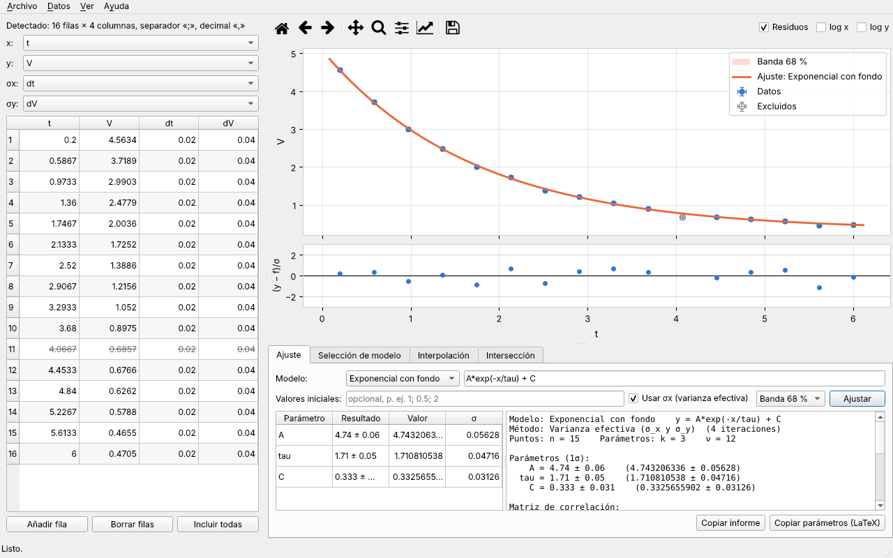
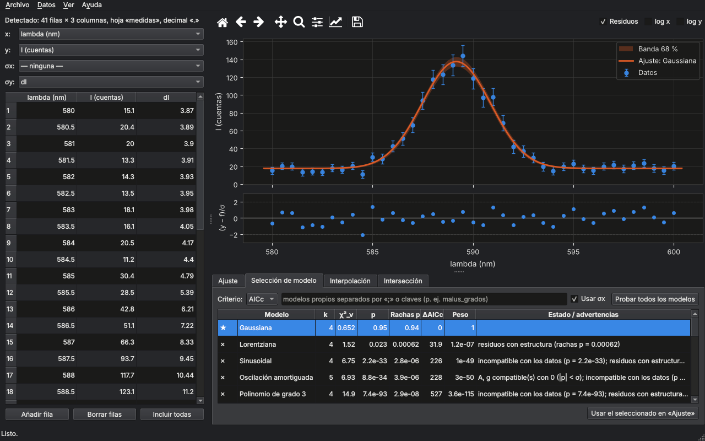
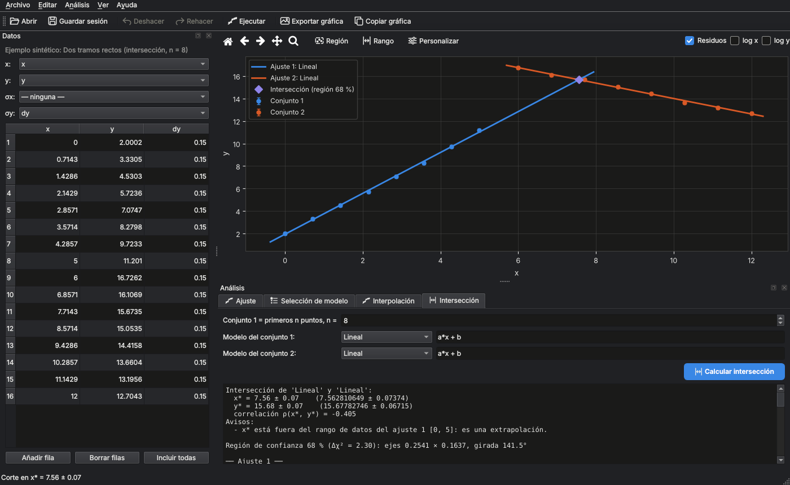

# ajustelab — ajuste de datos experimentales

[](https://github.com/WetZap/Programa_Python/actions/workflows/tests.yml)


Programa para **ajustar, comparar e interpolar datos de laboratorio** con una base estadística seria:
incertidumbres en x e y, χ² y p-valor, tests sobre los residuos, bandas de confianza, redondeo
correcto de resultados y **selección automática del modelo** que mejor describe los datos.

Nació en las prácticas del Grado en Física de la **Universidad de Granada** para dejar de escribir
un script distinto para cada ajuste. Se puede usar con **interfaz gráfica**, desde la **terminal**
o como **biblioteca de Python**.



| Selección automática de modelo (modo oscuro) | Intersección de dos ajustes |
|---|---|
|  |  |

---

## Índice

1. [Características](#características)
2. [Instalación](#instalación)
3. [Uso de la interfaz](#uso-de-la-interfaz)
4. [Formatos de datos](#formatos-de-datos)
5. [Uso desde la terminal](#uso-desde-la-terminal)
6. [Uso desde Python](#uso-desde-python)
7. [Base estadística](#base-estadística)
8. [Catálogo de modelos](#catálogo-de-modelos)
9. [Interpolación](#interpolación)
10. [Validación](#validación)
11. [Estructura del proyecto](#estructura-del-proyecto)
12. [Desarrollo](#desarrollo)
13. [Solución de problemas](#solución-de-problemas)
14. [Cambios respecto a `ProgramasUtiles.py`](#cambios-respecto-a-programasutilespy)
15. [Referencias](#referencias)

---

## Características

- **Lee casi cualquier fichero de datos**: csv, dat, txt, xlsx, ods, json, npy, mat... Detecta solo el
  separador, la coma decimal, la cabecera y las líneas de metadatos (osciloscopios, LabVIEW).
- **Incertidumbres en x e y**: mínimos cuadrados ponderados con σ_y; con σ_x, método de la
  *varianza efectiva*; sin incertidumbres, mínimos cuadrados ordinarios con errores escalados.
- **Bondad del ajuste completa**: χ², χ²_ν, p-valor, test de rachas, Shapiro–Wilk, Durbin–Watson,
  matriz de correlación, puntos atípicos y avisos que explican qué significa cada problema.
- **23 modelos** con valores iniciales automáticos y robustos, y **modelos propios** escritos como
  texto (`A*exp(-x/tau) + C`) con derivadas analíticas.
- **Selección automática**: ajusta todo el catálogo y recomienda un modelo por AICc o BIC, descartando
  los ajustes degenerados o físicamente imposibles.
- **Interpolación**: 10 métodos (splines, PCHIP, Akima, spline de suavizado...) con derivada, integral,
  inversa y propagación de errores por Monte Carlo.
- **Intersección de dos curvas** cualesquiera con su matriz de covarianza y elipse de confianza.
- **Resultados listos para el informe**: redondeo con la regla del PDG, tabla de parámetros en LaTeX,
  gráficas PNG/PDF/SVG a 300 ppp, tramos de spline en LaTeX/CSV.
- **Interfaz** con tema claro/oscuro que sigue al sistema, cálculos en segundo plano y exclusión de
  puntos con un clic. Funciona en **Windows, macOS y Linux** (X11 y Wayland).

---

## Instalación

Necesitas **Python 3.10 o superior**. Las dependencias (NumPy, SciPy, pandas, SymPy, matplotlib,
PySide6...) se instalan solas.

### Opción recomendada: pipx

[pipx](https://pipx.pypa.io) instala la aplicación aislada y deja los comandos `ajustelab` y
`ajustelab-cli` disponibles en todo el sistema:

```bash
pipx install git+https://github.com/WetZap/Programa_Python
ajustelab
```

### Paso a paso por sistema operativo

<details>
<summary><b>Windows</b></summary>

1. Instala Python desde [python.org](https://www.python.org/downloads/). En el instalador, marca
   **«Add python.exe to PATH»**.
2. Abre *PowerShell* y ejecuta:

   ```powershell
   py -m venv $HOME\ajustelab-venv
   & $HOME\ajustelab-venv\Scripts\Activate.ps1
   pip install https://github.com/WetZap/Programa_Python/archive/refs/heads/main.zip
   ajustelab
   ```

   Si PowerShell no deja activar el entorno, ejecuta antes
   `Set-ExecutionPolicy -Scope CurrentUser RemoteSigned`.
3. `ajustelab` se abre sin ventana de consola. Puedes crear un acceso directo a
   `%USERPROFILE%\ajustelab-venv\Scripts\ajustelab.exe`.

</details>

<details>
<summary><b>macOS</b></summary>

1. Instala Python desde [python.org](https://www.python.org/downloads/) o con Homebrew
   (`brew install python`).
2. En la Terminal:

   ```bash
   python3 -m venv ~/ajustelab-venv
   source ~/ajustelab-venv/bin/activate
   pip install git+https://github.com/WetZap/Programa_Python
   ajustelab
   ```

Funciona en Mac con Intel y con Apple Silicon. La interfaz usa el estilo nativo de macOS.

</details>

<details>
<summary><b>Linux</b></summary>

```bash
# Debian / Ubuntu / Mint
sudo apt install python3-venv python3-pip git libxcb-cursor0
# Fedora
sudo dnf install python3-pip git xcb-util-cursor
# Arch / Manjaro
sudo pacman -S python-pip git xcb-util-cursor

python3 -m venv ~/ajustelab-venv
source ~/ajustelab-venv/bin/activate
pip install git+https://github.com/WetZap/Programa_Python
ajustelab
```

- `libxcb-cursor0` (o `xcb-util-cursor`) lo exige Qt ≥ 6.5 en X11. Si falta, aparece el error
  *«Could not load the Qt platform plugin "xcb"»*.
- En Wayland funciona de forma nativa. Si tu compositor da problemas, prueba
  `QT_QPA_PLATFORM=xcb ajustelab`.
- Si tu escritorio no informa del modo claro/oscuro (i3, Sway sin portal, algunos XFCE), elige el
  tema a mano en **Ver → Tema**.

</details>

### Para desarrollar (clonando el repositorio)

```bash
git clone https://github.com/WetZap/Programa_Python.git
cd Programa_Python
python -m venv .venv && source .venv/bin/activate      # Windows: .venv\Scripts\activate
pip install -e ".[test]"
pytest -m "not lento"
```

---

## Uso de la interfaz

```bash
ajustelab                    # abre la ventana
ajustelab medidas.csv        # abre la ventana con un fichero
python -m ajustelab          # equivalente
```

1. **Carga los datos**: *Archivo → Abrir* (Ctrl+O), arrastra el fichero a la ventana, pega una tabla
   copiada de LibreOffice/Excel (Ctrl+Mayús+V) o escribe directamente en la tabla.
2. **Comprueba las columnas** x, y, σx y σy. Se asignan solas (ver [convenio](#asignación-de-columnas)),
   y σ puede ser una columna, ninguna o un valor *constante* (p. ej. la resolución del instrumento).
3. Elige una pestaña:

| Pestaña | Qué hace |
|---|---|
| **Ajuste** | Ajusta un modelo del catálogo o una expresión propia. Muestra parámetros, informe completo, banda de confianza (68/95 %) y residuos normalizados. |
| **Selección de modelo** | Prueba los 20 modelos automáticos (más los que añadas) y los ordena. ★ recomendado, ✓ compatible, ✗ incompatible. Doble clic → lo pasa a *Ajuste*. |
| **Interpolación** | Construye el interpolante y calcula f(x), f′(x), x tal que f(x) = y₀ e integrales, con error por Monte Carlo. Exporta los tramos. |
| **Intersección** | Divide la tabla en dos conjuntos (los *n* primeros puntos y el resto), ajusta cada uno y calcula el punto de corte con su elipse de confianza. |

4. **Excluye puntos con un clic** sobre la gráfica: la fila se tacha en la tabla y el ajuste se
   recalcula al momento. Otro clic lo vuelve a incluir; *Datos → Incluir todos los puntos* los
   recupera todos.
5. **Exporta**: *Archivo → Exportar gráfica* (PNG/PDF/SVG, 300 ppp), *Guardar informe*
   (texto de la pestaña activa) y *Copiar parámetros (LaTeX)*.

### Atajos

| Atajo | Acción |
|---|---|
| Ctrl+O | Abrir fichero |
| Ctrl+N | Tabla vacía |
| Ctrl+Mayús+V | Pegar el portapapeles como tabla nueva |
| Ctrl+C / Ctrl+V (en la tabla) | Copiar la selección / pegar un bloque desde la celda actual |
| Supr (en la tabla) | Vaciar las celdas seleccionadas |
| Doble clic en una cabecera | Renombrar la columna |
| Ctrl+E | Exportar gráfica |
| Ctrl+S | Guardar el informe de la pestaña activa |

En macOS, Ctrl equivale a ⌘.

---

## Formatos de datos

| Tipo | Extensiones | Qué se detecta automáticamente |
|---|---|---|
| Texto | `.csv .tsv .txt .dat .prn .asc .lvm .xy .out` | Codificación (UTF-8, UTF-16, Windows-1252), separador (`,` `;` tabulador `\|` espacios), coma decimal, comentarios (`#` `%` `//` `!`), cabecera también en un comentario (estilo gnuplot), metadatos de osciloscopios, delimitador final sobrante y exponentes Fortran (`1.0D-3`) |
| Hojas de cálculo | `.xlsx .xlsm .xls .ods` | Bloque numérico dentro de la hoja, ignorando títulos y notas. Si varias hojas tienen datos, pregunta cuál abrir. |
| Otros | `.json .npy .npz .mat .parquet .feather` | Vectores del mismo tamaño o matriz (se transpone si está guardada por filas). `.parquet` y `.feather` requieren `pip install pyarrow`. |

Las filas con huecos en las columnas usadas se ignoran y el programa avisa de cuántas son.

### Asignación de columnas

Si no indicas nada:

1. Si hay columnas cuyo nombre es el error de otra (`V` y `dV`, `t` y `t_err`, `I` y `sigma_I`), se
   emparejan por nombre.
2. Si no, se usa la posición: **2 columnas** → x, y · **3** → x, y, σy · **4 o más** → x, y, σx, σy
   (el mismo convenio que el script antiguo).

Las incertidumbres se interpretan como **desviaciones típicas (1σ)**.

---

## Uso desde la terminal

```bash
ajustelab-cli medidas.csv                                  # ajuste lineal
ajustelab-cli medidas.csv -m exponencial_fondo -g ajuste.png -o informe.txt
ajustelab-cli medidas.csv -m "A*exp(-x/tau) + C" --p0 "5;1.5;0"
ajustelab-cli medidas.csv --seleccionar --criterio bic     # prueba todo el catálogo
ajustelab-cli medidas.dat --x t --y V --dy-cte 0.05 --excluir 3,7
ajustelab-cli medidas.csv -i pchip --tramos tramos.tex     # interpolación
ajustelab-cli --modelos                                    # lista del catálogo
ajustelab-cli --help
```

Las columnas se indican por nombre o por posición (empezando en 0). En `--p0` los valores se separan
con `;` para que la coma decimal no sea ambigua.

---

## Uso desde Python

```python
from ajustelab import cargar, ajustar, seleccionar, interpolar, intersecar_datos, dividir

datos = cargar("ejemplos/descarga_rc.csv")          # detecta formato y columnas
res = ajustar(datos, "exponencial_fondo")            # o ajustar(datos, "V0*exp(-x/tau) + Vinf")
print(res.resumen())                                 # informe completo
tau, sigma_tau = res.parametros["tau"]

b = res.bondad()                                     # χ², p-valor, rachas, AICc...
print(b.chi2_red, b.p_valor, b.avisos)
f, inferior, superior = res.banda([1.0, 2.0], nivel=0.95)

sel = seleccionar(datos)                             # selección automática
print(sel.resumen())
print(sel.tabla())                                   # DataFrame con la clasificación

spline = interpolar(datos, "pchip")
r = spline.monte_carlo(lambda g: g.integral(1, 3))   # valor ± σ por Monte Carlo
print(r.nominal, r.sigma)

corte = intersecar_datos(*dividir(cargar("ejemplos/dos_rectas.dat"), 8))
print(corte.resumen())
```

Para redondear cualquier resultado: `formatear(3.14159, 0.0234)` → `"3.142 ± 0.023"`.

En `ejemplos/` hay tres demos ejecutables (`demo_fase1.py`, `demo_fase2.py`, `demo_fase3.py`) y
tres ficheros de datos sintéticos en formatos distintos.

---

## Base estadística

### Incertidumbres

| Datos | Método | Covarianza de los parámetros |
|---|---|---|
| σ_y | Mínimos cuadrados ponderados: minimiza $\chi^2=\sum_i\left(\frac{y_i-f(x_i;\mathbf p)}{\sigma_i}\right)^2$ | Absoluta: $C=(J^\mathsf{T}WJ)^{-1}$ |
| σ_x (y σ_y) | **Varianza efectiva** (Orear, 1982), iterada hasta converger: $\sigma_{\mathrm{ef},i}^2=\sigma_{y,i}^2+\left(\partial_x f\right)^2\sigma_{x,i}^2$ | Absoluta |
| Ninguna | Mínimos cuadrados ordinarios | Escalada por $s^2=\mathrm{RSS}/\nu$ (sin test χ²) |

- Los modelos lineales en los parámetros (polinomios, $a/x+b$...) se resuelven **de forma exacta**
  por SVD, sin valores iniciales.
- Los no lineales usan Levenberg–Marquardt con **jacobiano analítico** (SymPy) y **arranque múltiple**.
  Los valores iniciales se obtienen por *proyección variable*: se recorre una rejilla del parámetro no
  lineal (τ, ω...) y el resto se resuelve exactamente en cada punto.

### Bondad del ajuste

| Indicador | Interpretación |
|---|---|
| $\chi^2_\nu=\chi^2/\nu$, con $\nu=n-k$ | ≈ 1 → compatible; ≫ 1 → modelo incorrecto o σ subestimadas; ≪ 1 → σ sobreestimadas |
| $p=P(\chi^2_\nu\ge\chi^2_\text{obs})$ | p < 0.01 → incompatible; p > 0.99 → σ sospechosamente grandes |
| **Test de rachas** (Wald–Wolfowitz, distribución exacta) | Pocas rachas de residuos del mismo signo → **falta un término en el modelo**, aunque χ²_ν parezca bueno |
| Shapiro–Wilk (n ≥ 8) | Residuos no normales → posibles atípicos |
| Durbin–Watson | ≈ 2 si los residuos no están autocorrelacionados |
| Correlación $\rho_{ij}=C_{ij}/\sqrt{C_{ii}C_{jj}}$ | \|ρ\| > 0.95 → parámetros casi degenerados (conviene centrar x o reparametrizar) |
| $R^2$ ponderado | Solo informativo; **no** sirve para comparar modelos no lineales |

Si p < 0.05 y atribuyes el exceso de χ² a errores subestimados, el informe da también las σ
multiplicadas por $\sqrt{\chi^2_\nu}$ (criterio del PDG).

**Bandas** (método delta): $\sigma_f^2(x)=J(x)\,C\,J(x)^\mathsf{T}$. La banda de predicción añade la
dispersión de una medida nueva.

**Redondeo** (regla del PDG): se miran las tres primeras cifras del error. De 100 a 354 → 2 cifras
significativas; de 355 a 949 → 1 cifra; de 950 a 999 → se sube a 1000 con 2 cifras. El valor se
redondea a la misma posición decimal: `3.14159 ± 0.0234 → 3.142 ± 0.023`.

### Selección de modelo

Elegir el modelo con menor χ² **siempre favorece al que tiene más parámetros**. Por eso se usa

```math
\mathrm{AICc}=\chi^2+2k+\frac{2k(k+1)}{n-k-1},\qquad \mathrm{BIC}=\chi^2+k\ln n,
\qquad w_i\propto e^{-\Delta_i/2}.
```

1. Se **excluyen** los ajustes que no convergen, los degenerados, los que tienen ν < 2, los que tienen
   datos fuera del dominio del modelo y los **físicamente implausibles** (un pico con el centro fuera
   del rango de x, una frecuencia por encima de Nyquist, una sigmoide que no se completa...).
2. Entre los modelos **compatibles** (p ≥ 0.01 y rachas p ≥ 0.05) se toma el de menor criterio. Si
   otros quedan a Δ < 2 (estadísticamente indistinguibles), se recomienda el de **menos parámetros**.

> **La recomendación es estadística, no física.** Si la teoría predice un modelo, usa ese. En la
> validación (abajo), los fallos son siempre un modelo con un parámetro de más que absorbe ruido.

### Intersección

Para $g(x^*;\mathbf p_1,\mathbf p_2)=f_1-f_2=0$, el teorema de la función implícita da
$\partial x^*/\partial\mathbf p_1=-(\partial f_1/\partial\mathbf p_1)/g'$ y
$\partial x^*/\partial\mathbf p_2=(\partial f_2/\partial\mathbf p_2)/g'$. La covarianza de $(x^*,y^*)$
es $G\,\mathrm{diag}(C_1,C_2)\,G^\mathsf{T}$. La elipse del 68 % usa $\Delta\chi^2=2.30$ (dos grados de
libertad); la elipse «de 1σ» por eje solo contiene el 39 %. Se supone que los dos conjuntos son
independientes.

---

## Catálogo de modelos

| Clave | Modelo | Expresión |
|---|---|---|
| `constante` | Constante | $c$ |
| `proporcional` | Proporcional | $ax$ |
| `lineal` | Lineal | $ax+b$ |
| `cuadratico` | Cuadrático | $ax^2+bx+c$ |
| `cubico` | Polinomio de grado 3 | $c_0+c_1x+c_2x^2+c_3x^3$ |
| `inversa` | Inversa | $a/x+b$ |
| `inversa_cuadrado` | Inversa del cuadrado | $a/x^2+b$ |
| `raiz` | Raíz cuadrada | $a\sqrt{x}+b$ |
| `logaritmica` | Logarítmica | $a\ln x+b$ |
| `exponencial` | Exponencial | $Ae^{bx}$ |
| `exponencial_fondo` | Exponencial con fondo | $Ae^{-x/\tau}+C$ |
| `carga` ¹ | Carga de un condensador | $A(1-e^{-x/\tau})+C$ |
| `doble_exponencial` | Doble exponencial ($t_1<t_2$) | $A_1e^{-x/t_1}+A_2e^{-x/t_2}+C$ |
| `arrhenius` | Arrhenius | $Ae^{-b/x}$ |
| `potencia` | Potencia | $Ax^b$ |
| `potencia_fondo` | Potencia con fondo | $Ax^b+C$ |
| `gaussiana` | Gaussiana | $Ae^{-(x-\mu)^2/2s^2}+C$ |
| `lorentziana` | Lorentziana | $A\gamma^2/((x-x_0)^2+\gamma^2)+C$ |
| `logistica` | Logística (sigmoide) | $L/(1+e^{-k(x-x_0)})+C$ |
| `seno` | Sinusoidal | $A\sin(\omega x+\varphi)+C$ |
| `seno_amortiguado` | Oscilación amortiguada | $Ae^{-gx}\sin(\omega x+\varphi)+C$ |
| `malus` ¹ | Ley de Malus (rad) | $I_0\cos^2(x-t_0)+C$ |
| `malus_grados` ¹ | Ley de Malus (grados) | $I_0\cos^2(\pi(x-t_0)/180)+C$ |

¹ No entran en la selección automática: `carga` es la misma curva que `exponencial_fondo`, y Malus es
demasiado específico. Se pueden añadir con el campo *modelos propios* (o `--extra`). Los polinomios de
cualquier grado se piden como `polinomio_5`.

**Modelos propios**: cualquier expresión en `x` con `+ - * / ** ^`, las funciones
`exp log ln log10 sqrt sin cos tan asin acos atan sinh cosh tanh abs erf` y las constantes `pi` y `e`.
Cualquier otro nombre es un parámetro, incluidos `gamma`, `beta`, `E` o `I`.

---

## Interpolación

Un interpolante **pasa por todos los puntos e ignora las incertidumbres**: úsalo para tablas y
calibraciones sin ruido. Con datos ruidosos usa el *spline de suavizado* o, mejor aún, un ajuste.

| Método | Cuándo usarlo |
|---|---|
| `lineal` | Muchos puntos, o cuando no quieres introducir curvatura |
| `natural` | Spline cúbico con f″ = 0 en los extremos |
| `not-a-knot` | Spline cúbico por defecto de SciPy; reproduce exactamente un cúbico |
| `clamped` | Conoces f′ en los extremos |
| `periodico` | Datos periódicos (y₀ = yₙ) |
| `pchip` | Datos monótonos: no sobreoscila |
| `akima`, `makima` | Robustos frente a un punto que se sale de la tendencia |
| `suavizado` | Datos con ruido: spline penalizado, pesos 1/σ² y λ por validación cruzada |
| `polinomio` | Pocos puntos (fenómeno de Runge con más de 10) |

---

## Validación

La batería de tests (`pytest`, más de 180 pruebas) comprueba, entre otras cosas:

- **Frente a soluciones conocidas**: fórmulas cerradas de la recta ponderada, `numpy.polyfit`,
  `scipy.optimize.curve_fit`, la varianza efectiva para una recta (que es analítica), la
  distribución exacta de rachas frente a la enumeración de todos los casos, y el redondeo PDG.
- **Monte Carlo de las incertidumbres**: en cientos de conjuntos sintéticos, los *pulls*
  $(\hat p-p_\text{real})/\sigma_p$ siguen una $N(0,1)$, $\langle\chi^2_\nu\rangle\approx1$ y los
  p-valores son uniformes. Esto se comprueba para mínimos cuadrados ponderados, ajustes no lineales,
  varianza efectiva y mínimos cuadrados ordinarios (cobertura de la t de Student).
- **Catálogo**: los 23 modelos recuperan sus parámetros verdaderos dentro de 4σ.
- **Selección**: acierta el modelo verdadero en ≈ 95 % de los casos (23 familias, varias semillas).
- **Intersección**: los pulls de x* e y* y su correlación coinciden con la covarianza calculada; la
  elipse del 68 % contiene el 68.3 % de los puntos simulados.
- **Interfaz**: arranque, temas, apertura, ajuste, clic para excluir, selección con cancelación,
  interpolación, intersección, pegado y exportación, todo sin pantalla.

La CI de GitHub ejecuta los tests en **Ubuntu, Windows y macOS** con Python 3.10, 3.13 y 3.14.

---

## Estructura del proyecto

```
Programa_Python/
├── ajustelab/
│   ├── datos.py           # lectura multiformato y asignación de columnas
│   ├── modelos.py         # modelos (SymPy), catálogo y valores iniciales
│   ├── ajuste.py          # WLS / varianza efectiva / OLS, arranque múltiple
│   ├── estadistica.py     # bondad, tests, bandas, AICc/BIC, redondeo, informe
│   ├── seleccion.py       # selección automática de modelo
│   ├── interpolacion.py   # splines, PCHIP, Akima, suavizado, Monte Carlo
│   ├── interseccion.py    # corte de dos curvas con covarianza
│   ├── cli.py             # ajustelab-cli
│   └── gui/               # interfaz PySide6: app, tema, tabla, gráfica, paneles, trabajos
├── tests/                 # pytest (núcleo, Monte Carlo, interfaz, terminal)
├── ejemplos/              # datos sintéticos y demos
├── docs/capturas/
├── legacy/ProgramasUtiles.py   # script original, conservado como referencia
├── .github/workflows/tests.yml
└── pyproject.toml
```

---

## Desarrollo

```bash
pip install -e ".[test]"
pytest -m "not lento"      # rápido (~1 min): todo menos las validaciones Monte Carlo largas
pytest                     # completo (~2-3 min)
pytest -m gui              # solo la interfaz (sin pantalla)
```

Los tests de la interfaz usan `QT_QPA_PLATFORM=offscreen`, así que no abren ventanas. Las
contribuciones son bienvenidas mediante *fork* y *pull request*.

---

## Solución de problemas

| Síntoma | Causa y solución |
|---|---|
| `command not found: ajustelab` tras instalar | Se ha instalado una versión antigua sin interfaz. Comprueba con `pip show ajustelab` (debe ser ≥ 1.0.0) y actualiza con `pip install --upgrade git+https://github.com/WetZap/Programa_Python`. Comprueba también que el entorno está activado (`source ~/ajustelab-venv/bin/activate`). En zsh, ejecuta `rehash` si el comando acaba de instalarse. |
| zsh pregunta `correct 'pip' to '_pip' [nyae]?` | Es la autocorrección de zsh: responde `n`. Para que no vuelva a pasar, usa `python -m pip ...` o añade `unsetopt correct` a `~/.zshrc`. |
| *Could not load the Qt platform plugin "xcb"* | Falta `libxcb-cursor0` / `xcb-util-cursor` (ver [Linux](#instalación)). |
| La ventana no sigue el modo oscuro | Tu escritorio no informa del esquema de color: elige el tema en **Ver → Tema**. |
| En Windows, los símbolos χ² o ± salen mal al redirigir la salida de `ajustelab-cli` | Usa `PYTHONIOENCODING=utf-8` o el informe con `-o informe.txt`, que siempre está en UTF-8. |

---

## Cambios respecto a `ProgramasUtiles.py`

El script original se conserva en `legacy/`. Tenía fallos que **afectan a los resultados**:

| Opción antigua | Fallo | Ahora |
|---|---|---|
| 6 (y = ax) | Calculaba `a` con las fórmulas de y = ax + b y descartaba `b`, con ν = N−2. Con datos y = 2x + 5 daba a = 2.000 en vez de 2.714. **Si la usaste en un informe, revísalo.** | `ajustar(datos, "proporcional")`: a = Σwxy/Σwx², ν = n−1 |
| 4 (intersección) | El cálculo estaba indentado dentro de otra función y nunca se ejecutaba; además, la covarianza salía escalar | Intersección de cualquier par de modelos con covarianza 2×2 y elipse correcta |
| 1, 2, 3, 8 | σx se leía pero no se usaba; χ² sin ν ni p-valor; curva dibujada uniendo los puntos | Varianza efectiva, bondad completa, curva suave con banda |
| 7 (spline) | Un CSV de 4 columnas se leía mal; cabecera repetida en cada tramo | Diez métodos y exportación de tramos en txt, LaTeX y CSV |
| 8 (no lineal) | Un solo parámetro, `eval` sin control y p0 = 1 | Expresiones con cualquier número de parámetros, valores iniciales automáticos y arranque múltiple |

`scipy.odr`, que usaba la opción 4, está obsoleto desde SciPy 1.17 y desaparece en la 1.19.

---

## Referencias

- J. Orear, *Least squares when both variables have uncertainties*, Am. J. Phys. **50**, 912 (1982).
- Particle Data Group, *Review of Particle Physics*, capítulos «Introduction» (redondeo, factor de
  escala) y «Statistics».
- K. P. Burnham y D. R. Anderson, *Model Selection and Multimodel Inference*, Springer (2002).
- A. Wald y J. Wolfowitz, *On a test whether two samples are from the same population*,
  Ann. Math. Statist. **11**, 147 (1940).
- P. R. Bevington y D. K. Robinson, *Data Reduction and Error Analysis for the Physical Sciences*.

---

## Licencia

[MIT](LICENSE) © 2026 Jorge del Río López (WetZap). Puedes usar, modificar y distribuir el código
manteniendo la atribución.
