# ajustelab — ajuste de datos experimentales

[](https://github.com/WetZap/Programa_Python/actions/workflows/tests.yml)


Programa para **ajustar, comparar e interpolar datos de laboratorio** con una base estadística seria:
incertidumbres en x e y, χ² y p-valor, tests sobre los residuos, bandas de confianza, redondeo
correcto de resultados y **selección automática del modelo** que mejor describe los datos.

Nació en las prácticas del Grado en Física de la **Universidad de Granada** para dejar de escribir
un script distinto para cada ajuste. Se puede usar con **interfaz gráfica**, desde la **terminal**
o como **biblioteca de Python**.

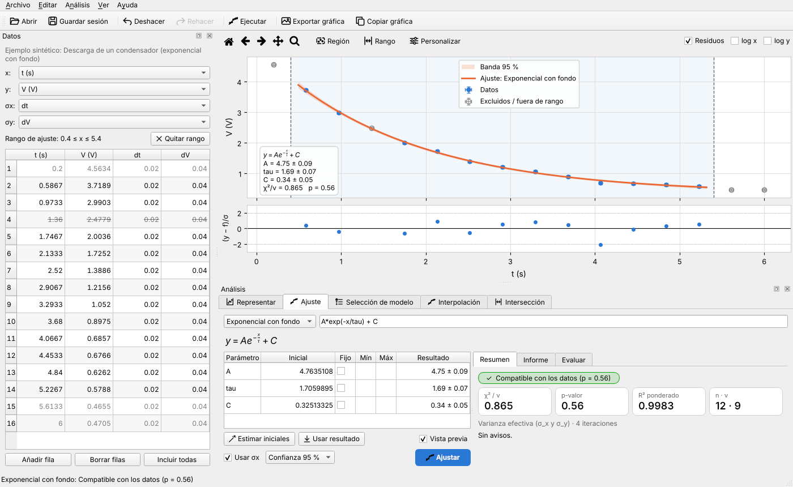

| Selección automática de modelo (modo oscuro) | Intersección de dos ajustes |
|---|---|
| 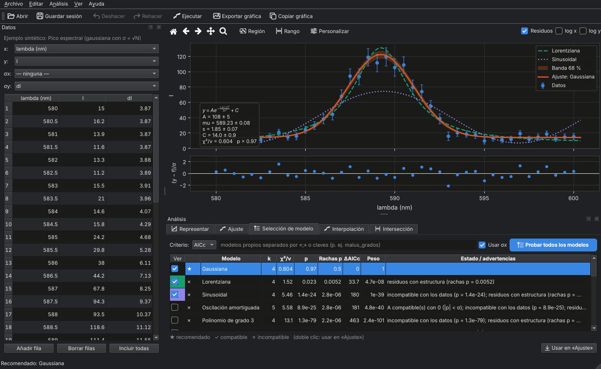 | 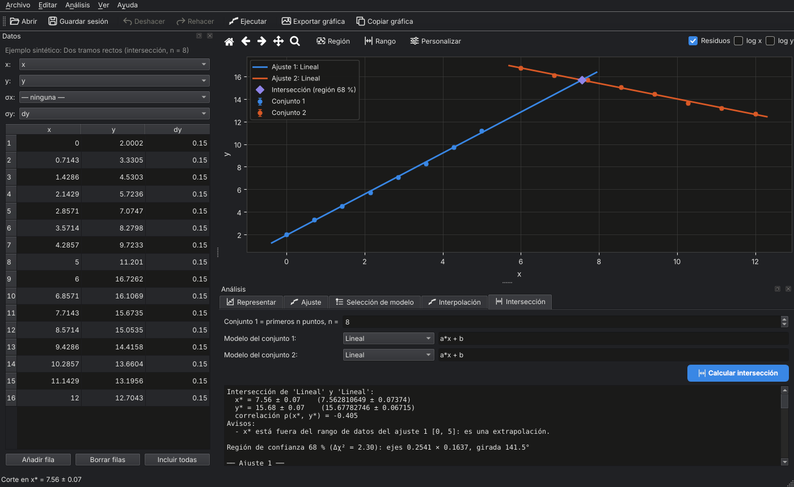 |

---

## Índice

1. [Características](#características)
2. [Instalación](#instalación)
3. [Uso de la interfaz](#uso-de-la-interfaz)
4. [Formatos de datos](#formatos-de-datos)
5. [Uso desde la terminal](#uso-desde-la-terminal)
6. [Uso desde Python](#uso-desde-python)
7. [Base estadística](#base-estadística)
8. [Catálogo de modelos](#catálogo-de-modelos)
9. [Interpolación](#interpolación)
10. [Validación](#validación)
11. [Estructura del proyecto](#estructura-del-proyecto)
12. [Desarrollo](#desarrollo)
13. [Solución de problemas](#solución-de-problemas)
14. [Cambios respecto a `ProgramasUtiles.py`](#cambios-respecto-a-programasutilespy)
15. [Referencias](#referencias)

---

## Características

- **Lee casi cualquier fichero de datos**: csv, dat, txt, xlsx, ods, json, npy, mat... Detecta solo el
  separador, la coma decimal, la cabecera y las líneas de metadatos (osciloscopios, LabVIEW).
- **Incertidumbres en x e y**: mínimos cuadrados ponderados con σ_y; con σ_x, método de la
  *varianza efectiva*; sin incertidumbres, mínimos cuadrados ordinarios con errores escalados.
- **Bondad del ajuste completa**: χ², χ²_ν, p-valor, test de rachas, Shapiro–Wilk, Durbin–Watson,
  matriz de correlación, puntos atípicos y avisos que explican qué significa cada problema.
- **23 modelos** con valores iniciales automáticos y robustos, y **modelos propios** escritos como
  texto (`A*exp(-x/tau) + C`) con derivadas analíticas.
- **Selección automática**: ajusta todo el catálogo y recomienda un modelo por AICc o BIC, descartando
  los ajustes degenerados o físicamente imposibles.
- **Interpolación**: 10 métodos (splines, PCHIP, Akima, spline de suavizado...) con derivada, integral,
  inversa y propagación de errores por Monte Carlo.
- **Intersección de dos curvas** cualesquiera con su matriz de covarianza y elipse de confianza.
- **Resultados listos para el informe**: redondeo con la regla del PDG, tabla de parámetros en LaTeX,
  gráficas PNG/PDF/SVG a 300 ppp, tramos de spline en LaTeX/CSV.
- **Representar sin ajustar**: varias columnas frente a una misma x, con eje y izquierdo y derecho (o
  paneles apilados), con o sin barras de error, y con el **eje x partido** (`//`) para saltarse tramos
  sin datos.
- **Más tipos de gráfica**: **histogramas** (con errores √N, varias reglas para los intervalos y ajuste
  de una normal, Poisson o exponencial con test χ²), **barras**, **sectores**, **cajas / violín** y
  **polar**. La tabla admite **columnas de texto** (etiquetas) para las categorías.
- **Interfaz cómoda**: vista previa del modelo, parámetros fijos y con límites, exclusión de puntos
  con un clic o por región, rango de ajuste arrastrando, deshacer/rehacer, comparación de modelos
  superpuestos, sesiones `.ajustelab`, exportación para publicación y coma decimal opcional.
- **Gráficas a tu gusto**: el título, la leyenda, las etiquetas de los ejes y los textos se arrastran
  sobre la gráfica; límites de los ejes, marcas hacia dentro y en los cuatro lados, notación
  científica, leyenda fuera o en columnas, tamaños y colores, textos con flecha y **plantillas de
  estilo** (de fábrica, como *Revista (física)*, o las tuyas).
- **Tipografía Inter** en la interfaz y en las gráficas (incluida, no hace falta instalarla), con
  cifras tabulares en las tablas. **Tema claro/oscuro** que sigue al sistema y cálculos en segundo plano. Funciona en **Windows,
  macOS y Linux** (X11 y Wayland).

---

## Instalación

Necesitas **Python 3.10 o superior**. Las dependencias (NumPy, SciPy, pandas, SymPy, matplotlib,
PySide6...) se instalan solas.

### Linux: instalador de una línea (recomendado)

```bash
curl -fsSL https://raw.githubusercontent.com/WetZap/Programa_Python/main/instalar.sh | sh
```

Funciona en Arch, Manjaro, EndeavourOS, CachyOS, Debian, Ubuntu, Mint, Pop!_OS, Fedora, openSUSE,
Void y sus derivadas. La CI lo prueba en contenedores limpios de Arch, Debian, Ubuntu 22.04, Fedora y
openSUSE Tumbleweed, abriendo la ventana en X11. Todo queda en tu usuario, sin tocar el Python
del sistema:

1. Busca Python ≥ 3.10 con `venv`; si no lo hay, ofrece instalarlo.
2. Crea un entorno propio en `~/.local/share/ajustelab/venv`. Así se evita el error
   *externally-managed-environment* de Arch, Debian o Fedora.
3. Deja las órdenes `ajustelab` y `ajustelab-cli` en `~/.local/bin`. Si esa carpeta no está en el
   PATH (en Arch no lo está por defecto), ofrece añadirla a tu `.bashrc`, `.zshrc` o a fish.
4. Detecta qué bibliotecas del sistema le faltan a Qt (la típica es `xcb-util-cursor`) y ofrece
   instalarlas con `pacman`, `apt`, `dnf`, `zypper` o `xbps-install`.
5. Añade **ajustelab al menú de aplicaciones** con su icono (GNOME, KDE Plasma, XFCE, Cinnamon, MATE,
   LXQt, COSMIC, o lanzadores como rofi, wofi y fuzzel en Hyprland o Sway). Además, asocia las sesiones
   `.ajustelab` para abrirlas con doble clic.
6. Comprueba que la interfaz arranca.

Siempre pregunta antes de instalar paquetes del sistema. Con `-y` responde que sí a todo:
`curl -fsSL …/instalar.sh | sh -s -- -y`.

| | |
|---|---|
| **Actualizar** | Vuelve a ejecutar la misma línea. También repara el entorno si una actualización del sistema cambió la versión de Python (pasa en Arch). |
| **Desde una copia clonada** | `sh instalar.sh` dentro del repositorio instala esa copia. |
| **Desinstalar** | `curl -fsSL …/instalar.sh \| sh -s -- --desinstalar` (o `sh instalar.sh --desinstalar`). |
| **Más opciones** | `sh instalar.sh --ayuda`: `--sin-menu`, `--sin-dependencias`, `--python RUTA`, `--rama RAMA`. |

Si prefieres leer el script antes de ejecutarlo:
`curl -fsSLO https://raw.githubusercontent.com/WetZap/Programa_Python/main/instalar.sh`, ábrelo y
luego `sh instalar.sh`.

### Windows 10/11: instalador de una línea (recomendado)

En **PowerShell** (menú Inicio → «PowerShell»; no hace falta abrirlo como administrador):

```powershell
irm https://raw.githubusercontent.com/WetZap/Programa_Python/main/instalar.ps1 | iex
```

Es el equivalente del instalador de Linux. Todo queda en tu usuario, sin permisos de administrador:

1. Busca Python ≥ 3.10 (lanzador `py` o PATH). Si no lo hay, ofrece instalar Python 3.13 con
   `winget`, sin abrir ninguna web.
2. Crea un entorno propio en `%LOCALAPPDATA%\Programs\ajustelab` e instala ajustelab ahí.
3. Deja las órdenes `ajustelab` y `ajustelab-cli` en su carpeta `bin` y la añade al PATH de tu
   usuario (en una terminal nueva ya funcionan).
4. Crea el acceso directo del **menú Inicio** (y, si quieres, del escritorio) con su icono. Además,
   asocia los ficheros `.ajustelab` para abrirlos con doble clic.
5. Lo registra en **Configuración → Aplicaciones**, desde donde se desinstala como cualquier programa.
6. Comprueba que la interfaz arranca.

| | |
|---|---|
| **Actualizar** | Vuelve a ejecutar la misma línea (si ajustelab está abierto, ofrece cerrarlo). |
| **Desinstalar** | Configuración → Aplicaciones → ajustelab → Desinstalar. |
| **Sin preguntas** | `& ([scriptblock]::Create((irm https://raw.githubusercontent.com/WetZap/Programa_Python/main/instalar.ps1))) -Si` |
| **Desde una copia clonada** | `powershell -ExecutionPolicy Bypass -File instalar.ps1` dentro del repositorio. |

Funciona con Windows PowerShell 5.1 (el que trae Windows) y con PowerShell 7. Si prefieres leer el
script antes, descárgalo con `irm …/instalar.ps1 -OutFile instalar.ps1`, ábrelo y ejecútalo con la
última orden de la tabla.

### Con pipx (cualquier sistema)

[pipx](https://pipx.pypa.io) instala la aplicación aislada y deja los comandos `ajustelab` y
`ajustelab-cli` disponibles en todo el sistema:

```bash
pipx install git+https://github.com/WetZap/Programa_Python
ajustelab --instalar-escritorio      # menú de aplicaciones (Linux) o menú Inicio (Windows)
ajustelab
```

### Paso a paso por sistema operativo

<details>
<summary><b>Windows, a mano</b></summary>

1. Instala Python desde [python.org](https://www.python.org/downloads/) (marca **«Add python.exe to
   PATH»**) o con `winget install Python.Python.3.13`.
2. En *PowerShell*:

   ```powershell
   py -m venv $env:LOCALAPPDATA\Programs\ajustelab\venv
   & $env:LOCALAPPDATA\Programs\ajustelab\venv\Scripts\pip install https://github.com/WetZap/Programa_Python/archive/refs/heads/main.zip
   & $env:LOCALAPPDATA\Programs\ajustelab\venv\Scripts\ajustelab --instalar-escritorio
   ```

3. La última orden crea el acceso directo del menú Inicio y asocia los `.ajustelab`. `ajustelab.exe`
   se abre sin ventana de consola.

</details>

<details>
<summary><b>macOS</b></summary>

1. Instala Python desde [python.org](https://www.python.org/downloads/) o con Homebrew
   (`brew install python`).
2. En la Terminal:

   ```bash
   python3 -m venv ~/ajustelab-venv
   source ~/ajustelab-venv/bin/activate
   pip install git+https://github.com/WetZap/Programa_Python
   ajustelab
   ```

Funciona en Mac con Intel y con Apple Silicon. La interfaz usa el estilo nativo de macOS.

</details>

<details>
<summary><b>Linux, a mano</b></summary>

Es lo mismo que hace el instalador, paso a paso:

```bash
python3 -m venv ~/.local/share/ajustelab/venv
~/.local/share/ajustelab/venv/bin/pip install https://github.com/WetZap/Programa_Python/archive/refs/heads/main.tar.gz
ln -s ~/.local/share/ajustelab/venv/bin/ajustelab ~/.local/bin/
ajustelab --diagnostico            # dice qué paquetes del sistema faltan y con qué orden instalarlos
ajustelab --instalar-escritorio    # entrada en el menú, icono y doble clic en .ajustelab
```

- En Debian/Ubuntu hace falta antes `sudo apt install python3-venv`.
- Qt ≥ 6.5 exige `libxcb-cursor0` (Debian/Ubuntu/openSUSE) o `xcb-util-cursor` (Arch/Fedora) en X11.
  Si falta, aparece el error *«Could not load the Qt platform plugin "xcb"»*. `ajustelab` lo detecta
  y muestra la orden exacta antes de que Qt falle.
- En Wayland funciona de forma nativa. Si tu compositor da problemas, prueba
  `QT_QPA_PLATFORM=xcb ajustelab`.
- Si tu escritorio no informa del modo claro/oscuro (i3, Sway sin portal, algunos XFCE), elige el
  tema a mano en **Ver → Tema**.

</details>

### Para desarrollar (clonando el repositorio)

```bash
git clone https://github.com/WetZap/Programa_Python.git
cd Programa_Python
python -m venv .venv && source .venv/bin/activate      # Windows: .venv\Scripts\activate
pip install -e ".[test]"
pytest -m "not lento"
```

---

## Uso de la interfaz

```bash
ajustelab                    # abre la ventana (o búscalo en el menú de aplicaciones)
ajustelab medidas.csv        # abre la ventana con un fichero (o una sesión .ajustelab)
ajustelab --diagnostico      # comprueba Python, Qt, la sesión gráfica y las bibliotecas del sistema
ajustelab --help             # todas las opciones
python -m ajustelab          # equivalente a «ajustelab»
```

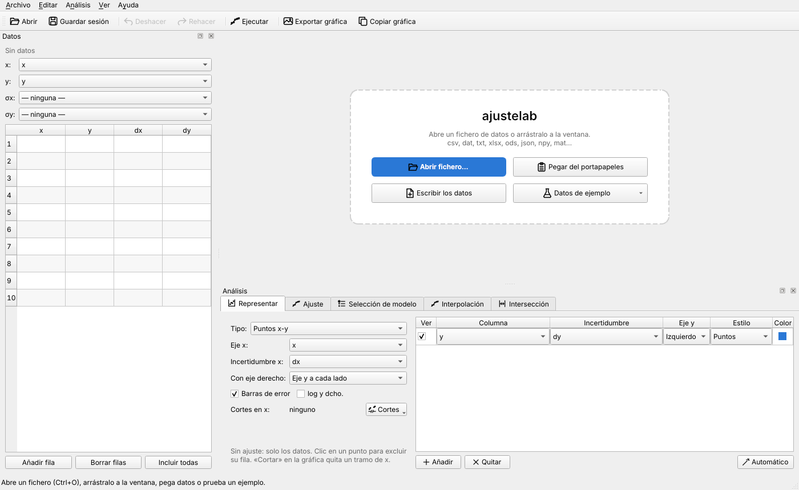

### Flujo de trabajo

1. **Carga los datos.** Usa *Abrir* (Ctrl+O), arrastra el fichero a la ventana, pega una tabla copiada de
   LibreOffice o Excel (Ctrl+Mayús+V) o escribe en una tabla vacía. Si es la primera vez, *Datos de
   ejemplo* carga diez conjuntos sintéticos: uno por cada tipo de análisis y de gráfica.
2. **Comprueba las columnas** x, y, σx y σy. Se asignan solas (ver [convenio](#asignación-de-columnas)).
   σ puede ser una columna, ninguna o un valor *constante* (p. ej. la resolución del instrumento).
3. **Elige una pestaña** y pulsa **Ctrl+Intro**:

| Pestaña | Qué hace |
|---|---|
| **Representar** | Dibuja las columnas que elijas **sin ajustar nada**: puntos x-y (cada serie con su incertidumbre, su eje y izquierdo o derecho, su estilo y su color, y el eje x partido si hace falta), histograma, barras, sectores, cajas / violín o polar. Ver [Representar datos](#representar-datos-sin-ajustar). |
| **Ajuste** | Ajusta un modelo del catálogo o una expresión propia. Tiene una tabla de parámetros con valor inicial, casilla *Fijo* y límites mín/máx, y una vista previa con los valores iniciales. Debajo están *Resumen* (veredicto, χ²/ν, p-valor, R²), *Informe* (texto y LaTeX) y *Evaluar* (f(x) ± σ, y la x que da un y₀ ± σ). |
| **Selección de modelo** | Prueba los 20 modelos automáticos (más los que añadas) y los ordena por AICc o BIC: ★ recomendado, ✓ compatible, ✗ incompatible. La columna *Ver* superpone hasta tres modelos en la gráfica para compararlos. Con doble clic, el modelo pasa a *Ajuste*. |
| **Interpolación** | Construye el interpolante y calcula f(x), f′(x), la x tal que f(x) = y₀ e integrales, con error por Monte Carlo. Exporta los tramos. |
| **Intersección** | Divide la tabla en dos conjuntos (los *n* primeros puntos y el resto), ajusta cada uno y calcula el punto de corte con su elipse de confianza. |

### Representar datos sin ajustar

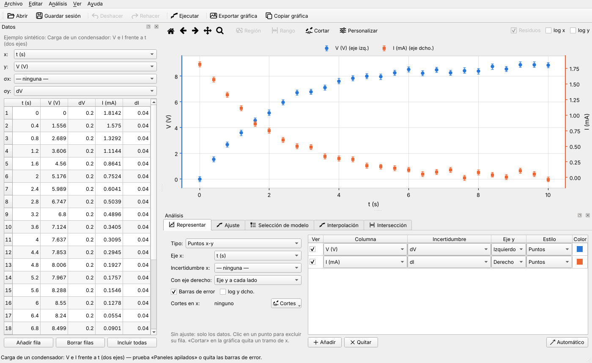

Al abrir un fichero, la pestaña **Representar** propone sola qué dibujar. La primera columna (o la
x del panel *Datos*) va al eje x, y cada columna que no sea una incertidumbre es una serie. Las
incertidumbres se emparejan por el nombre: `dV`, `V_err` o `σV` con `V (V)`. Con dos series de
escalas muy distintas, la segunda pasa al eje derecho. Todo se cambia en la tabla de series:

- **Incertidumbre**: la columna de σ de cada serie (y de x). *Barras de error* las enseña u oculta todas a la vez.
- **Eje y**: izquierdo o derecho. Cada eje se colorea como su serie, y la leyenda indica a qué eje
  pertenece cada una.
- **Estilo**: puntos, línea o puntos y línea. **Color**: clic para elegirlo, clic derecho para volver al
  automático. El color sigue a la serie: quitar una no cambia el de las demás.
- **Con eje derecho → Paneles apilados**: en vez de dos escalas en el mismo panel, dos paneles con la
  misma x.

> Con dos ejes y en el mismo panel, dónde se cruzan las curvas depende de cómo se escale cada eje, y
> puede sugerir una relación que no existe. Para comparar formas, los paneles apilados son más honestos.

Clic en un punto excluye su fila (afecta también a los ajustes). La escala logarítmica del eje
derecho está en *log y dcho.* y su etiqueta, en *Personalizar*.

El selector **Tipo** cambia entre puntos x-y y los demás tipos de gráfica. Cada tipo recuerda su
configuración, y todo se guarda en la sesión.

#### Eje x partido

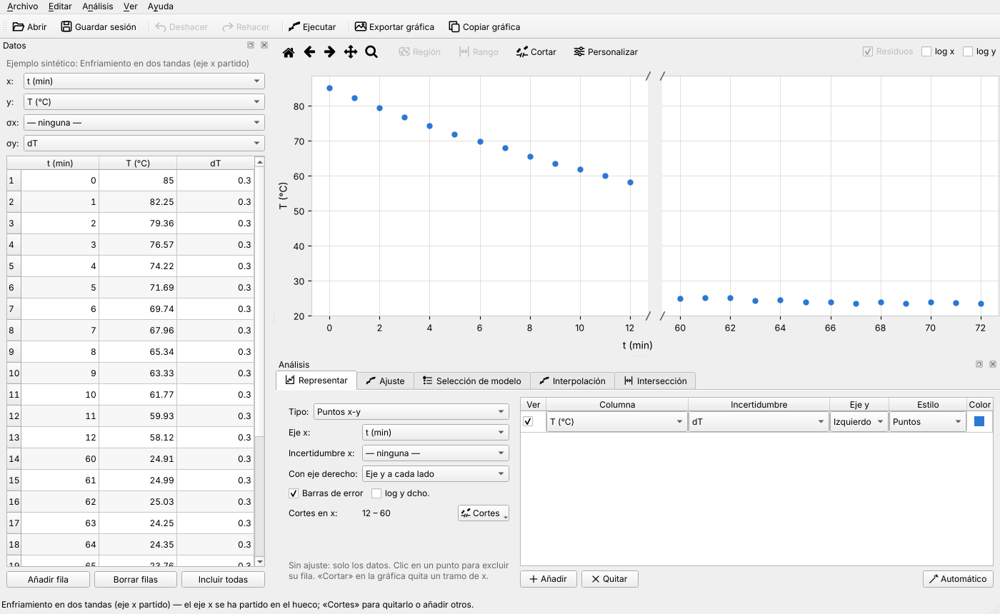

Cuando hay un tramo de x sin datos (dos tandas de medidas separadas, o un conjunto de en medio que
has borrado), el botón **Cortes** del panel lo quita y la gráfica se acorta: el eje se parte en tramos
con la misma escala, separados por `//`. Hay tres formas:

- **Cortar los huecos grandes**: detecta los saltos de x mucho mayores que el paso típico (más de 6
  veces y más del 12 % del rango).
- **Elegir el tramo en la gráfica**: activa la herramienta **Cortar** y arrastra en horizontal sobre lo que sobra.
- **Escribir el tramo**: `12; 45` quita lo que hay entre 12 y 45.

Los puntos que caen en un corte no se dibujan ni se exportan (siguen en la tabla). Funciona con los dos
ejes y, con paneles apilados y con escala logarítmica. Cada corte se quita desde el mismo menú.

#### Histograma

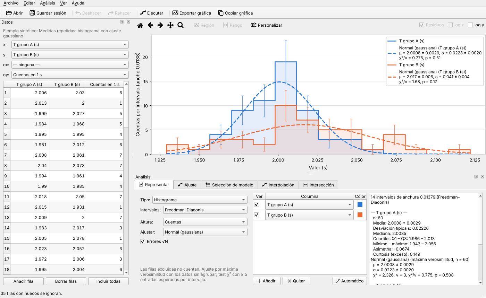

- **Columnas**: una o varias. Con varias se usan los mismos intervalos (calculados con todos los datos)
  y se dibujan como contornos para que se vean todas.
- **Intervalos**: *Freedman–Diaconis* (la de por defecto, robusta frente a colas y valores atípicos),
  *Scott*, *Sturges*, *√n*, número fijo o anchura fija. Con datos enteros (cuentas), los intervalos se
  centran en los enteros.
- **Altura**: cuentas, frecuencia relativa o densidad de probabilidad (área 1). **Errores √N** (Poisson).
- **Ajustar** una normal (μ, σ), una Poisson (λ) o una exponencial (τ) por máxima verosimilitud, con el
  test χ² de Pearson. A la derecha salen la estadística de cada columna (media ± error, desviación
  típica, mediana, cuartiles, asimetría, curtosis) y el resultado del ajuste. Ver
  [Histogramas](#histogramas) en la base estadística.

Al pasar el ratón por un intervalo se ven sus límites, N ± √N y las entradas esperadas por el ajuste.

#### Barras, sectores, cajas y polar

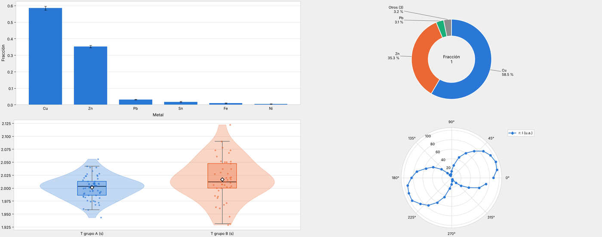

| Tipo | Qué dibuja |
|---|---|
| **Barras** | Una barra por fila. Las categorías salen de una columna de texto, de números o del número de fila. Una o varias series (barras agrupadas) con su incertidumbre; verticales u horizontales, en el orden de la tabla o de mayor a menor, con el valor encima si quieres. |
| **Sectores** | Una columna de valores (≥ 0) con sus etiquetas, en anillo (con el total en el centro) o tarta. Van de mayor a menor desde las 12 en sentido horario; los menores del umbral (3 % por defecto) se juntan en «Otros» y como mucho hay 8. *Ver como barras ordenadas* pasa los mismos datos a barras, que se comparan mejor. |
| **Cajas / violín** | Una caja por columna: mediana, cuartiles y bigotes de Tukey (1.5·IQR). Con violín se ve además la forma de la distribución; con *Puntos*, todos los datos; ◆ es la media. Al pasar el ratón salen n, media ± error, mediana, cuartiles y atípicos. |
| **Polar** | Ángulo θ (en grados o radianes) y una o varias series de radios, con 0 a la derecha y sentido antihorario (convenio matemático) o 0 arriba y sentido horario (brújula). |

Las filas excluidas no cuentan en histogramas, barras, sectores ni cajas; en x-y y polar se ven huecas.
En todos los tipos, *Exportar gráfica* guarda la figura y los números dibujados en CSV (intervalos y
cuentas, valores de las barras, estadísticos de las cajas…).

### Trabajar sobre la gráfica

- **Clic en un punto**: lo excluye o lo vuelve a incluir. La fila se tacha y el ajuste se recalcula al momento.
- **Región**: arrastra un rectángulo para excluir de una vez todos los puntos que encierra.
- **Rango**: arrastra en horizontal para ajustar solo un intervalo de x. Los puntos de fuera quedan en
  gris y se recuperan con *Quitar rango*.
- **Cuadro de resultados**: muestra la ecuación, los parámetros, χ²/ν y p. Se puede arrastrar a donde
  estorbe menos, y su posición se guarda.
- **Bandas**: de confianza al 68 % o al 95 % (incertidumbre de la curva) o de predicción al 95 %
  (además, la dispersión de una medida nueva).
- **Mover y editar sobre la gráfica**: arrastra el **título**, la **leyenda**, las **etiquetas de los
  ejes** o un **texto** a donde quieras (el cursor cambia al pasar por encima). **Doble clic** para
  editarlos (en la leyenda, abre sus opciones). **Clic derecho** para añadir un texto en ese punto o una
  flecha que lo señale, devolver un elemento a su sitio o restablecer todas las posiciones.
- **Personalizar**: todas las opciones de la gráfica (ver abajo).

#### Personalizar la gráfica

| Gráfica personalizada (plantilla *Revista*, leyenda y cuadro movidos, texto con flecha) | Diálogo *Personalizar* |
|---|---|
| 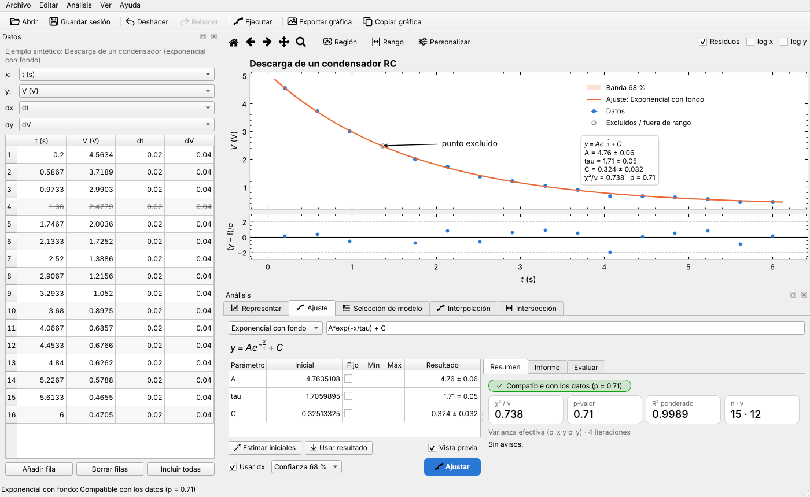 | 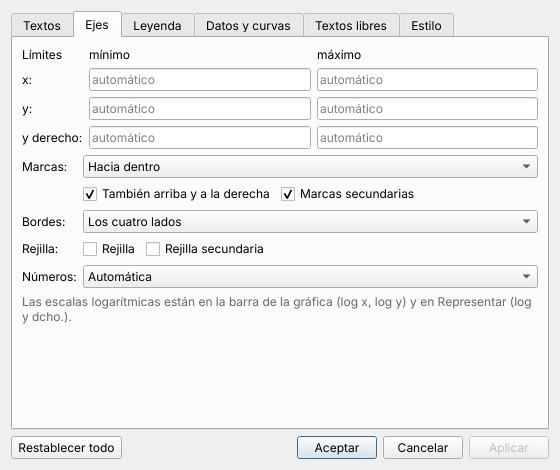 |

| Pestaña | Opciones |
|---|---|
| **Textos** | Título (alineación, tamaño, negrita), etiquetas de los ejes (admiten LaTeX, p. ej. `$V_0$ (V)`), tamaño de letra y un botón para devolver a su sitio lo que hayas movido. |
| **Ejes** | Límites de x, y e y derecho (vacío = automático), marcas hacia fuera, hacia dentro o a los dos lados, también arriba y a la derecha, marcas secundarias, bordes completos o solo abajo y a la izquierda, rejilla principal y secundaria, y notación de los números (automática, científica ×10ⁿ o sin exponente). |
| **Leyenda** | Mostrarla, posición (dentro, en 9 sitios, o fuera: a la derecha, encima o debajo), columnas, tamaño de letra, título y marco. |
| **Datos y curvas** | Tamaño de los puntos, grosor de las líneas, de las curvas ajustadas y de las barras de error, topes de las barras, color de los datos y del ajuste, y el cuadro de resultados. |
| **Textos libres** | Los textos añadidos: contenido, tamaño y, si señalan algo, las coordenadas de la flecha. |
| **Estilo** | Plantillas: *Por defecto*, *Revista (física)* (marcas hacia dentro en los cuatro lados, sin rejilla), *Presentación* (letra y líneas grandes), *Minimalista* y las que guardes tú. *Usar el estilo actual en las gráficas nuevas* lo deja como predeterminado. |

*Aplicar* enseña el cambio sin cerrar el diálogo. Una plantilla guarda solo el estilo, no los textos, los
límites ni las posiciones. Al abrir otros datos se borran el título, las etiquetas, los límites y los
textos (eran de los datos anteriores); el estilo y las posiciones se quedan. Todo va en la sesión y se
respeta al exportar: con otro tamaño de letra, el título, la leyenda y los textos cambian en proporción.

Todo lo que cambia los datos se puede **deshacer y rehacer** (Ctrl+Z / Ctrl+Mayús+Z): editar celdas,
pegar, renombrar columnas, excluir puntos o fijar el rango.

### Parámetros fijos y límites

En la tabla de parámetros de *Ajuste*:

- **Fijo** mantiene un parámetro en su valor inicial, por ejemplo el fondo C medido aparte. El ajuste
  se hace solo con los demás y los grados de libertad se cuentan bien.
- **Mín/Máx** acota un parámetro, por ejemplo τ > 0.
- **Usar resultado** copia los valores ajustados como iniciales para el siguiente intento.

Antes de ajustar se comprueban las incoherencias (mín > máx, inicial fuera de límites, todos fijos) y
se marcan en rojo.

### Exportar y guardar

| Acción | Resultado |
|---|---|
| *Exportar gráfica* (Ctrl+E) | Diálogo con vista previa al tamaño real (ver abajo). |
| *Copiar gráfica* (Ctrl+Mayús+C) | Con los últimos ajustes de exportación, como imagen y como SVG: Word pega la imagen; Inkscape y LibreOffice, la versión vectorial. |
| *Copiar LaTeX* (pestaña *Informe*) | Tabla `tabular` con los parámetros redondeados. |
| *Guardar sesión* (Ctrl+S) | Fichero `.ajustelab` (JSON) con la tabla, las columnas, los puntos excluidos, el rango, el modelo con sus parámetros fijos y límites, las opciones de la gráfica y la pestaña activa. Al abrirlo se recupera todo y se rehace el ajuste. |
| *Guardar informe* / *Exportar tabla* | Texto de la pestaña activa / datos en csv, xlsx… |

#### Exportar la gráfica

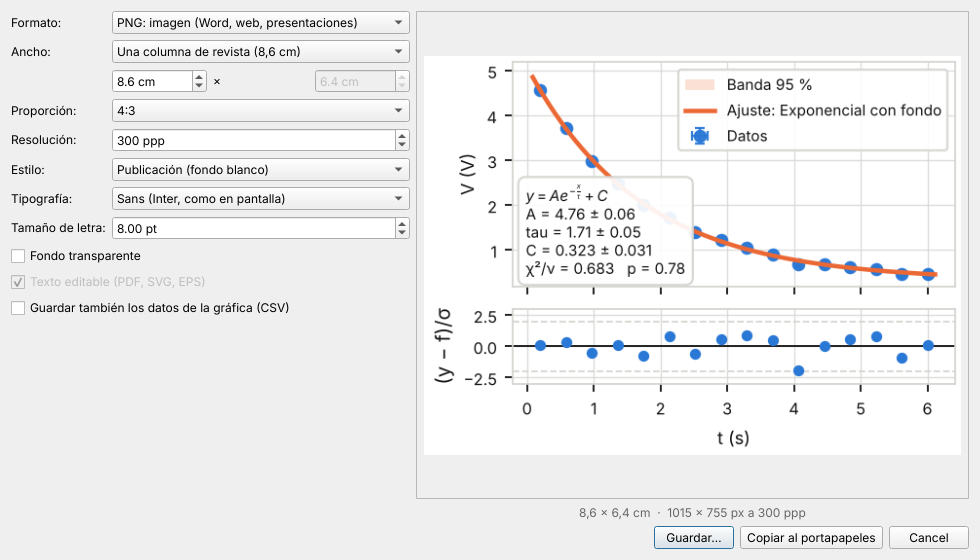

- **Vista previa** de cómo saldrá, a escala, con el tamaño final en cm y en píxeles.
- **Formatos**: PNG y TIFF (imagen; TIFF sin pérdidas, para imprenta), PDF, SVG y EPS (vectoriales). EPS
  no admite transparencias: las bandas de confianza saldrían opacas, y el diálogo lo avisa.
- **Tamaño exacto en cm**: anchos de revista (8,6 y 17,8 cm, los de APS), informe, diapositiva y póster,
  con proporción fija (4:3, 3:2, áurea, 16:9, 1:1) o libre. El fichero mide exactamente eso: el
  contenido se encaja dentro, no se recorta después.
- **Tipografía y tamaño de letra** propios de la exportación: *Sans* o *Serif* (STIX, tipo Times, con
  fórmulas a juego, como LaTeX con `newtx`). El tamaño es el real en el papel; las revistas suelen pedir 7–9 pt.
- **Texto editable**: en PDF y EPS las fuentes van incrustadas como TrueType (lo que piden las
  revistas); en SVG el texto sigue siendo texto, editable en Inkscape. Sin marcar, en SVG se convierte en trazos.
- **Estilo** *publicación* (fondo blanco aunque uses el tema oscuro) o *como en pantalla*, y fondo
  transparente.
- **Datos de la gráfica en CSV**: puntos, curva ajustada y bandas en ficheros junto a la figura
  (`figura_datos.csv`, `figura_ajuste.csv`…), para rehacerla con pgfplots o donde quieras.

Los ajustes se recuerdan entre sesiones.

*Abrir reciente* recuerda los 8 últimos ficheros. Al cerrar o abrir otro fichero con cambios sin guardar,
el programa pregunta antes de descartarlos.

### Personalización de la ventana

- **Tema**: *Ver → Tema* (sistema, claro u oscuro). Con *sistema* sigue al escritorio en vivo; en
  Windows 11 y macOS usa el estilo nativo y en Linux, Fusion.
- **Coma decimal**: *Ver → Coma decimal* muestra los resultados como `1,71 ± 0,05` en la interfaz,
  en la gráfica y en el LaTeX (`{,}`).
- **Paneles**: *Datos* y *Análisis* son paneles acoplables. Se pueden mover, desacoplar u ocultar, y la
  disposición se recuerda. *Ver → Restablecer disposición* vuelve a la original.

### Atajos

| Atajo | Acción |
|---|---|
| Ctrl+O | Abrir datos o sesión |
| Ctrl+S / Ctrl+Mayús+S | Guardar sesión / guardar como |
| Ctrl+N | Nueva sesión |
| Ctrl+Mayús+V | Pegar el portapapeles como tabla nueva |
| Ctrl+Z / Ctrl+Mayús+Z (o Ctrl+Y) | Deshacer / rehacer |
| Ctrl+Intro | Ejecutar la pestaña activa |
| Ctrl+1 … Ctrl+5 | Ir a Representar, Ajuste, Selección, Interpolación, Intersección |
| Ctrl+E / Ctrl+Mayús+C | Exportar gráfica / copiarla al portapapeles |
| Ctrl+C / Ctrl+V (en la tabla) | Copiar la selección / pegar un bloque desde la celda actual |
| Supr (en la tabla) | Vaciar las celdas seleccionadas |
| Doble clic en una cabecera | Renombrar la columna |

En macOS, Ctrl equivale a ⌘. La lista también está en *Ayuda → Atajos de teclado*.

> **Pista:** en *Ayuda → Acerca de* hay algo más que la versión. 😉

---

## Formatos de datos

| Tipo | Extensiones | Qué se detecta automáticamente |
|---|---|---|
| Texto | `.csv .tsv .txt .dat .prn .asc .lvm .xy .out` | Codificación (UTF-8, UTF-16, Windows-1252), separador (`,` `;` tabulador `\|` espacios), coma decimal, comentarios (`#` `%` `//` `!`), cabecera también en un comentario (estilo gnuplot), metadatos de osciloscopios, delimitador final sobrante y exponentes Fortran (`1.0D-3`) |
| Hojas de cálculo | `.xlsx .xlsm .xls .ods` | Bloque numérico dentro de la hoja, ignorando títulos y notas. Si varias hojas tienen datos, pregunta cuál abrir. |
| Otros | `.json .npy .npz .mat .parquet .feather` | Vectores del mismo tamaño o matriz (se transpone si está guardada por filas). `.parquet` y `.feather` requieren `pip install pyarrow`. |

Las filas con huecos en las columnas usadas se ignoran y el programa avisa de cuántas son.

Una **columna de etiquetas** (texto: `Cu`, `Muestra 1`, `2026-01-05`…) junto a columnas de números se lee
como texto en vez de rechazar el fichero; sirve para las categorías de las barras y los sectores. En la
tabla también se puede escribir o pegar texto. Las columnas de texto no aparecen en x, y, σx ni σy.

### Asignación de columnas

Si no indicas nada:

1. Si hay columnas cuyo nombre es el error de otra (`V` y `dV`, `t` y `t_err`, `I` y `sigma_I`), se
   emparejan por nombre.
2. Si no, se usa la posición: **2 columnas** → x, y · **3** → x, y, σy · **4 o más** → x, y, σx, σy
   (el mismo convenio que el script antiguo).

Las incertidumbres se interpretan como **desviaciones típicas (1σ)**.

---

## Uso desde la terminal

```bash
ajustelab-cli medidas.csv                                  # ajuste lineal
ajustelab-cli medidas.csv -m exponencial_fondo -g ajuste.png -o informe.txt
ajustelab-cli medidas.csv -m "A*exp(-x/tau) + C" --p0 "5;1.5;0"
ajustelab-cli medidas.csv --seleccionar --criterio bic     # prueba todo el catálogo
ajustelab-cli medidas.dat --x t --y V --dy-cte 0.05 --excluir 3,7
ajustelab-cli medidas.csv -i pchip --tramos tramos.tex     # interpolación
ajustelab-cli --modelos                                    # lista del catálogo
ajustelab-cli --help
```

Las columnas se indican por nombre o por posición (empezando en 0). En `--p0` los valores se separan
con `;` para que la coma decimal no sea ambigua.

---

## Uso desde Python

```python
import numpy as np
from ajustelab import cargar, ajustar, seleccionar, interpolar, intersecar_datos, dividir

datos = cargar("ejemplos/descarga_rc.csv")          # detecta formato y columnas
res = ajustar(datos, "exponencial_fondo")            # o ajustar(datos, "V0*exp(-x/tau) + Vinf")
print(res.resumen())                                 # informe completo
tau, sigma_tau = res.parametros["tau"]

b = res.bondad()                                     # χ², p-valor, rachas, AICc...
print(b.chi2_red, b.p_valor, b.avisos)
f, inferior, superior = res.banda([1.0, 2.0], nivel=0.95)

res = ajustar(datos, "exponencial_fondo", fijos={"C": 0.32},        # C fijo
              limites=([-np.inf, 0], [np.inf, np.inf]))               # τ ≥ 0 (libres: A, tau)
print(res.sigma_f([1.0, 2.0]))                       # σ de la curva en esos x
print(res.inversa(2.0, sigma_y0=0.04))               # [(x, σx)] tal que f(x) = 2.0

sel = seleccionar(datos)                             # selección automática
print(sel.resumen())
print(sel.tabla())                                   # DataFrame con la clasificación

spline = interpolar(datos, "pchip")
r = spline.monte_carlo(lambda g: g.integral(1, 3))   # valor ± σ por Monte Carlo
print(r.nominal, r.sigma)

corte = intersecar_datos(*dividir(cargar("ejemplos/dos_rectas.dat"), 8))
print(corte.resumen())
```

Para redondear cualquier resultado: `formatear(3.14159, 0.0234)` → `"3.142 ± 0.023"`.

Histogramas con su estadística:

```python
from ajustelab.histograma import ajustar_distribucion, histograma, resumen

h = histograma(medidas)                    # Freedman–Diaconis; también "scott", "sturges", "raiz",
                                           # intervalos=20 o ancho=0.5
y, dy = h.valores("densidad")              # alturas y errores √N en la normalización pedida
a = ajustar_distribucion(medidas, "normal", h)
print(a.texto())                           # μ ± σ_μ, σ ± σ_σ, χ², ν y p
print(resumen(medidas).filas())            # media ± error, mediana, cuartiles…
```

En `ejemplos/` hay tres demos ejecutables (`demo_fase1.py`, `demo_fase2.py`, `demo_fase3.py`) y
tres ficheros de datos sintéticos en formatos distintos.

---

## Base estadística

### Incertidumbres

| Datos | Método | Covarianza de los parámetros |
|---|---|---|
| σ_y | Mínimos cuadrados ponderados: minimiza $\chi^2=\sum_i\left(\frac{y_i-f(x_i;\mathbf p)}{\sigma_i}\right)^2$ | Absoluta: $C=(J^\mathsf{T}WJ)^{-1}$ |
| σ_x (y σ_y) | **Varianza efectiva** (Orear, 1982), iterada hasta converger: $\sigma_{\mathrm{ef},i}^2=\sigma_{y,i}^2+\left(\partial_x f\right)^2\sigma_{x,i}^2$ | Absoluta |
| Ninguna | Mínimos cuadrados ordinarios | Escalada por $s^2=\mathrm{RSS}/\nu$ (sin test χ²) |

- Los modelos lineales en los parámetros (polinomios, $a/x+b$...) se resuelven **de forma exacta**
  por SVD, sin valores iniciales.
- Los no lineales usan Levenberg–Marquardt con **jacobiano analítico** (SymPy) y **arranque múltiple**.
  Los valores iniciales se obtienen por *proyección variable*: se recorre una rejilla del parámetro no
  lineal (τ, ω...) y el resto se resuelve exactamente en cada punto.

### Bondad del ajuste

| Indicador | Interpretación |
|---|---|
| $\chi^2_\nu=\chi^2/\nu$, con $\nu=n-k$ | ≈ 1 → compatible; ≫ 1 → modelo incorrecto o σ subestimadas; ≪ 1 → σ sobreestimadas |
| $p=P(\chi^2_\nu\ge\chi^2_\text{obs})$ | p < 0.01 → incompatible; p > 0.99 → σ sospechosamente grandes |
| **Test de rachas** (Wald–Wolfowitz, distribución exacta) | Pocas rachas de residuos del mismo signo → **falta un término en el modelo**, aunque χ²_ν parezca bueno |
| Shapiro–Wilk (n ≥ 8) | Residuos no normales → posibles atípicos |
| Durbin–Watson | ≈ 2 si los residuos no están autocorrelacionados |
| Correlación $\rho_{ij}=C_{ij}/\sqrt{C_{ii}C_{jj}}$ | \|ρ\| > 0.95 → parámetros casi degenerados (conviene centrar x o reparametrizar) |
| $R^2$ ponderado | Solo informativo; **no** sirve para comparar modelos no lineales |

Si p < 0.05 y atribuyes el exceso de χ² a errores subestimados, el informe da también las σ
multiplicadas por $\sqrt{\chi^2_\nu}$ (criterio del PDG).

**Bandas** (método delta): $\sigma_f^2(x)=J(x)\,C\,J(x)^\mathsf{T}$. La banda de predicción añade la
dispersión de una medida nueva.

**Redondeo** (regla del PDG): se miran las tres primeras cifras del error. De 100 a 354 → 2 cifras
significativas; de 355 a 949 → 1 cifra; de 950 a 999 → se sube a 1000 con 2 cifras. El valor se
redondea a la misma posición decimal: `3.14159 ± 0.0234 → 3.142 ± 0.023`.

### Selección de modelo

Elegir el modelo con menor χ² **siempre favorece al que tiene más parámetros**. Por eso se usa

```math
\mathrm{AICc}=\chi^2+2k+\frac{2k(k+1)}{n-k-1},\qquad \mathrm{BIC}=\chi^2+k\ln n,
\qquad w_i\propto e^{-\Delta_i/2}.
```

1. Se **excluyen** los ajustes que no convergen, los degenerados, los que tienen ν < 2, los que tienen
   datos fuera del dominio del modelo y los **físicamente implausibles** (un pico con el centro fuera
   del rango de x, una frecuencia por encima de Nyquist, una sigmoide que no se completa...).
2. Entre los modelos **compatibles** (p ≥ 0.01 y rachas p ≥ 0.05) se toma el de menor criterio. Si
   otros quedan a Δ < 2 (estadísticamente indistinguibles), se recomienda el de **menos parámetros**.

> **La recomendación es estadística, no física.** Si la teoría predice un modelo, usa ese. En la
> validación (abajo), los fallos son siempre un modelo con un parámetro de más que absorbe ruido.

### Histogramas

- **Intervalos**: Freedman–Diaconis, $h=2\,\mathrm{IQR}\,n^{-1/3}$; Scott, $h=3.49\,s\,n^{-1/3}$;
  Sturges, $k=\lceil\log_2 n\rceil+1$ (solo razonable con pocos datos normales); $\sqrt n$. Si el IQR
  es 0 (muchos valores repetidos) se usa Sturges. Como mucho 500 intervalos.
- **Errores**: $\sqrt N$ en cada intervalo. Con $N=0$ la barra es 0, lo que no significa que no haya
  incertidumbre: ahí $\sqrt N$ deja de ser una buena aproximación.
- **Ajuste** por máxima verosimilitud con los **datos sin agrupar** (no con el histograma, que pierde
  información y depende de los intervalos): normal, $\hat\mu=\bar x\pm s/\sqrt n$ y
  $\hat\sigma=s\pm s/\sqrt{2(n-1)}$; Poisson, $\hat\lambda=\bar x\pm\sqrt{\hat\lambda/n}$; exponencial,
  $\hat\tau=\bar x\pm\hat\tau/\sqrt n$.
- **Test χ² de Pearson**: los intervalos de los extremos se extienden hasta el final del soporte y se
  agrupan intervalos vecinos hasta que cada grupo espera al menos 5 entradas;
  $\nu=k-1-(\text{parámetros estimados})$. Al estimar con los datos sin agrupar el p-valor es algo
  optimista (Chernoff–Lehmann), poco con muchos intervalos. En la validación, con datos que siguen la
  distribución, $p<0.05$ sale en el 5 % de los casos para las tres distribuciones.

### Intersección

Para $g(x^*;\mathbf p_1,\mathbf p_2)=f_1-f_2=0$, el teorema de la función implícita da
$\partial x^*/\partial\mathbf p_1=-(\partial f_1/\partial\mathbf p_1)/g'$ y
$\partial x^*/\partial\mathbf p_2=(\partial f_2/\partial\mathbf p_2)/g'$. La covarianza de $(x^*,y^*)$
es $G\,\mathrm{diag}(C_1,C_2)\,G^\mathsf{T}$. La elipse del 68 % usa $\Delta\chi^2=2.30$ (dos grados de
libertad); la elipse «de 1σ» por eje solo contiene el 39 %. Se supone que los dos conjuntos son
independientes.

---

## Catálogo de modelos

| Clave | Modelo | Expresión |
|---|---|---|
| `constante` | Constante | $c$ |
| `proporcional` | Proporcional | $ax$ |
| `lineal` | Lineal | $ax+b$ |
| `cuadratico` | Cuadrático | $ax^2+bx+c$ |
| `cubico` | Polinomio de grado 3 | $c_0+c_1x+c_2x^2+c_3x^3$ |
| `inversa` | Inversa | $a/x+b$ |
| `inversa_cuadrado` | Inversa del cuadrado | $a/x^2+b$ |
| `raiz` | Raíz cuadrada | $a\sqrt{x}+b$ |
| `logaritmica` | Logarítmica | $a\ln x+b$ |
| `exponencial` | Exponencial | $Ae^{bx}$ |
| `exponencial_fondo` | Exponencial con fondo | $Ae^{-x/\tau}+C$ |
| `carga` ¹ | Carga de un condensador | $A(1-e^{-x/\tau})+C$ |
| `doble_exponencial` | Doble exponencial ($t_1<t_2$) | $A_1e^{-x/t_1}+A_2e^{-x/t_2}+C$ |
| `arrhenius` | Arrhenius | $Ae^{-b/x}$ |
| `potencia` | Potencia | $Ax^b$ |
| `potencia_fondo` | Potencia con fondo | $Ax^b+C$ |
| `gaussiana` | Gaussiana | $Ae^{-(x-\mu)^2/2s^2}+C$ |
| `lorentziana` | Lorentziana | $A\gamma^2/((x-x_0)^2+\gamma^2)+C$ |
| `logistica` | Logística (sigmoide) | $L/(1+e^{-k(x-x_0)})+C$ |
| `seno` | Sinusoidal | $A\sin(\omega x+\varphi)+C$ |
| `seno_amortiguado` | Oscilación amortiguada | $Ae^{-gx}\sin(\omega x+\varphi)+C$ |
| `malus` ¹ | Ley de Malus (rad) | $I_0\cos^2(x-t_0)+C$ |
| `malus_grados` ¹ | Ley de Malus (grados) | $I_0\cos^2(\pi(x-t_0)/180)+C$ |

¹ No entran en la selección automática: `carga` es la misma curva que `exponencial_fondo`, y Malus es
demasiado específico. Se pueden añadir con el campo *modelos propios* (o `--extra`). Los polinomios de
cualquier grado se piden como `polinomio_5`.

**Modelos propios**: cualquier expresión en `x` con `+ - * / ** ^`, las funciones
`exp log ln log10 sqrt sin cos tan asin acos atan sinh cosh tanh abs erf` y las constantes `pi` y `e`.
Cualquier otro nombre es un parámetro, incluidos `gamma`, `beta`, `E` o `I`.

---

## Interpolación

Un interpolante **pasa por todos los puntos e ignora las incertidumbres**: úsalo para tablas y
calibraciones sin ruido. Con datos ruidosos usa el *spline de suavizado* o, mejor aún, un ajuste.

| Método | Cuándo usarlo |
|---|---|
| `lineal` | Muchos puntos, o cuando no quieres introducir curvatura |
| `natural` | Spline cúbico con f″ = 0 en los extremos |
| `not-a-knot` | Spline cúbico por defecto de SciPy; reproduce exactamente un cúbico |
| `clamped` | Conoces f′ en los extremos |
| `periodico` | Datos periódicos (y₀ = yₙ) |
| `pchip` | Datos monótonos: no sobreoscila |
| `akima`, `makima` | Robustos frente a un punto que se sale de la tendencia |
| `suavizado` | Datos con ruido: spline penalizado, pesos 1/σ² y λ por validación cruzada |
| `polinomio` | Pocos puntos (fenómeno de Runge con más de 10) |

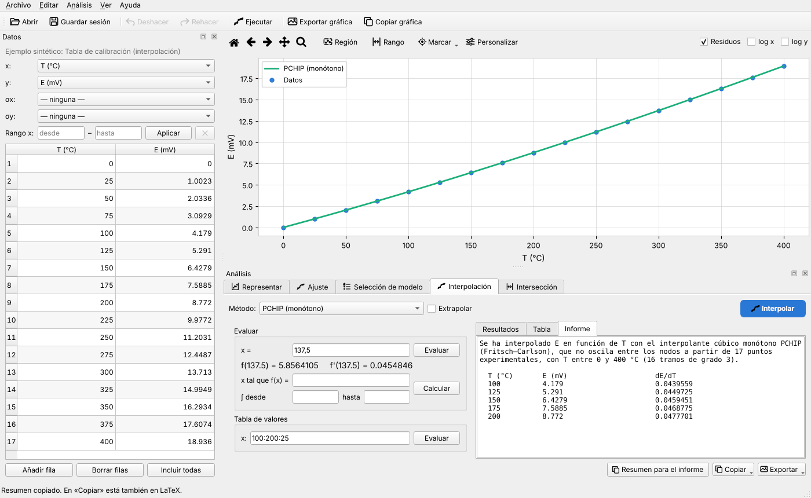

---

## Validación

La batería de tests (`pytest`, más de 280 pruebas) comprueba, entre otras cosas:

- **Frente a soluciones conocidas**: fórmulas cerradas de la recta ponderada, `numpy.polyfit`,
  `scipy.optimize.curve_fit`, la varianza efectiva para una recta (que es analítica), la
  distribución exacta de rachas frente a la enumeración de todos los casos, y el redondeo PDG.
- **Monte Carlo de las incertidumbres**: en cientos de conjuntos sintéticos, los *pulls*
  $(\hat p-p_\text{real})/\sigma_p$ siguen una $N(0,1)$, $\langle\chi^2_\nu\rangle\approx1$ y los
  p-valores son uniformes. Esto se comprueba para mínimos cuadrados ponderados, ajustes no lineales,
  varianza efectiva y mínimos cuadrados ordinarios (cobertura de la t de Student).
- **Catálogo**: los 23 modelos recuperan sus parámetros verdaderos dentro de 4σ.
- **Selección**: acierta el modelo verdadero en ≈ 95 % de los casos (23 familias, varias semillas).
- **Intersección**: los pulls de x* e y* y su correlación coinciden con la covarianza calculada; la
  elipse del 68 % contiene el 68.3 % de los puntos simulados.
- **Histogramas**: las reglas de intervalos coinciden con las de NumPy; los ajustes recuperan sus
  parámetros y, con datos que siguen la distribución, el p-valor del test χ² es uniforme (p < 0.05 en
  ≈ 5 % de 400 conjuntos) para la normal, la Poisson y la exponencial.
- **Interfaz**: arranque, temas, apertura, ajuste, clic para excluir, selección con cancelación,
  interpolación, intersección, pegado, columnas de texto, todos los tipos de gráfica, eje partido,
  arrastre y edición de título, leyenda, etiquetas y textos, plantillas y exportación, todo sin pantalla.

La CI de GitHub ejecuta los tests en **Ubuntu, Windows y macOS** con Python 3.10, 3.13 y 3.14.

---

## Estructura del proyecto

```
Programa_Python/
├── ajustelab/
│   ├── datos.py           # lectura multiformato y asignación de columnas
│   ├── modelos.py         # modelos (SymPy), catálogo y valores iniciales
│   ├── ajuste.py          # WLS / varianza efectiva / OLS, arranque múltiple
│   ├── estadistica.py     # bondad, tests, bandas, AICc/BIC, redondeo, informe
│   ├── seleccion.py       # selección automática de modelo
│   ├── interpolacion.py   # splines, PCHIP, Akima, suavizado, Monte Carlo
│   ├── interseccion.py    # corte de dos curvas con covarianza
│   ├── histograma.py      # intervalos, errores √N, ajuste de distribuciones y test χ²
│   ├── fuentes.py         # tipografía Inter (Qt y matplotlib)
│   ├── cli.py             # ajustelab-cli
│   ├── lanzador.py        # orden ajustelab: opciones de sistema y arranque de la interfaz
│   ├── sistema.py         # diagnóstico: distro, sesión X11/Wayland, bibliotecas de Qt
│   ├── escritorio.py      # menú de aplicaciones, icono y tipo de fichero (freedesktop y Windows)
│   ├── windows.py         # acceso directo con AppUserModelID y asociación de .ajustelab
│   ├── recursos/fuentes/  # Inter 4.1 (subconjunto latino, griego y matemático) y su licencia OFL
│   └── gui/               # interfaz PySide6
│       ├── app.py         #   ventana, menús, paneles acoplables, deshacer, sesiones
│       ├── tabla.py       #   tabla editable (con deshacer) y asignación de columnas
│       ├── grafica.py     #   gráfica, región/rango, cuadro de resultados
│       ├── paneles.py     #   pestañas de análisis
│       ├── representar.py #   pestaña Representar (tipo de gráfica, series, cortes del eje x)
│       ├── graficas.py    #   histograma, barras, sectores, cajas / violín y polar
│       ├── dialogos.py    #   exportar gráfica (vista previa, formatos, CSV)
│       ├── personalizar.py #  opciones de la gráfica por pestañas y plantillas de estilo
│       ├── sesion.py      #   ficheros .ajustelab
│       ├── tema.py, estilo.py, iconos.py, widgets.py, ejemplos.py, acerca.py, trabajos.py
│       └── recursos/      #   icono de la aplicación y sorpresa (ver LEEME.txt)
├── tests/                 # pytest (núcleo, Monte Carlo, interfaz, terminal)
├── ejemplos/              # datos sintéticos y demos
├── docs/capturas/
├── instalar.sh            # instalador para Linux
├── instalar.ps1           # instalador para Windows
├── legacy/ProgramasUtiles.py   # script original, conservado como referencia
├── .github/workflows/tests.yml
└── pyproject.toml
```

---

## Desarrollo

```bash
pip install -e ".[test]"
pytest -m "not lento"      # rápido (~1 min): todo menos las validaciones Monte Carlo largas
pytest                     # completo (~3-4 min)
pytest -m gui              # solo la interfaz (sin pantalla)
```

Los tests de la interfaz usan `QT_QPA_PLATFORM=offscreen`, así que no abren ventanas. El
instalador de Linux se comprueba con `shellcheck -s sh instalar.sh`, y la CI lo ejecuta en
contenedores de cinco distribuciones. El de Windows pasa PSScriptAnalyzer y se prueba con Windows
PowerShell 5.1 y PowerShell 7, también con `irm | iex`. Las
contribuciones son bienvenidas mediante *fork* y *pull request*.

---

## Solución de problemas

Lo primero, en una terminal:

```bash
ajustelab --diagnostico
```

Indica la versión de Python y de Qt, la distribución, si la sesión es X11 o Wayland, qué bibliotecas
faltan (con la orden para instalarlas), si la entrada del menú está bien y si `~/.local/bin` está en
el PATH.

| Síntoma | Causa y solución |
|---|---|
| Al hacer clic en el menú no pasa nada, o sale el aviso *«El entorno de ajustelab ya no funciona»* | Una actualización del sistema cambió la versión de Python (habitual en Arch) y el entorno ya no sirve. Vuelve a ejecutar el instalador: lo detecta y lo rehace. |
| *Could not load the Qt platform plugin "xcb"* | Faltan bibliotecas de X11. `ajustelab` muestra antes la orden exacta para tu distribución; el instalador las instala si le dices que sí. |
| `command not found: ajustelab` tras instalar | `~/.local/bin` no está en el PATH: abre una terminal nueva (el instalador ofrece añadirlo) o, en zsh, ejecuta `rehash`. Si la versión es antigua (`ajustelab --version` < 1.1), vuelve a ejecutar el instalador: sustituye las instalaciones anteriores. |
| `error: externally-managed-environment` al usar `pip install` | Tu distribución protege el Python del sistema (PEP 668). Usa el instalador, pipx o un entorno virtual; no hace falta `--break-system-packages`. |
| En Wayland, la ventana aparece con un icono genérico en el dock | En Wayland el icono sale de la entrada del menú: ejecuta `ajustelab --instalar-escritorio`. |
| zsh pregunta `correct 'pip' to '_pip' [nyae]?` | Es la autocorrección de zsh: responde `n`. Para que no vuelva a pasar, usa `python -m pip ...` o añade `unsetopt correct` a `~/.zshrc`. |
| La ventana no sigue el modo oscuro | Tu escritorio no informa del esquema de color: elige el tema en **Ver → Tema**. |
| Windows: `irm` no funciona o dice que la ejecución de scripts está deshabilitada | `irm … \| iex` no ejecuta ningún fichero, así que la directiva de ejecución no le afecta. Si tu organización bloquea PowerShell, usa la instalación a mano o pipx. |
| Windows: `ajustelab` no se reconoce justo después de instalar | Abre una terminal nueva: las que ya estaban abiertas no ven el PATH actualizado. Desde el menú Inicio funciona siempre. |
| Windows: la barra de tareas muestra el icono de Python | Vuelve a crear el acceso directo con `ajustelab --instalar-escritorio` (o reinstala): el acceso y la ventana comparten identificador para agruparse. |
| NixOS o Alpine | Los paquetes de Qt de PyPI no funcionan ahí: Alpine usa musl, y NixOS no tiene las bibliotecas en rutas estándar. En NixOS usa `python3Packages.pyside6` o activa `programs.nix-ld`. |
| En Windows, los símbolos χ² o ± salen mal al redirigir la salida de `ajustelab-cli` | Usa `PYTHONIOENCODING=utf-8` o el informe con `-o informe.txt`, que siempre está en UTF-8. |

Para ver todos los avisos de Qt (algunos se ocultan porque solo llenan la terminal), arranca con
`AJUSTELAB_DEPURAR=1 ajustelab`.

---

## Cambios respecto a `ProgramasUtiles.py`

El script original se conserva en `legacy/`. Tenía fallos que **afectan a los resultados**:

| Opción antigua | Fallo | Ahora |
|---|---|---|
| 6 (y = ax) | Calculaba `a` con las fórmulas de y = ax + b y descartaba `b`, con ν = N−2. Con datos y = 2x + 5 daba a = 2.000 en vez de 2.714. **Si la usaste en un informe, revísalo.** | `ajustar(datos, "proporcional")`: a = Σwxy/Σwx², ν = n−1 |
| 4 (intersección) | El cálculo estaba indentado dentro de otra función y nunca se ejecutaba; además, la covarianza salía escalar | Intersección de cualquier par de modelos con covarianza 2×2 y elipse correcta |
| 1, 2, 3, 8 | σx se leía pero no se usaba; χ² sin ν ni p-valor; curva dibujada uniendo los puntos | Varianza efectiva, bondad completa, curva suave con banda |
| 7 (spline) | Un CSV de 4 columnas se leía mal; cabecera repetida en cada tramo | Diez métodos y exportación de tramos en txt, LaTeX y CSV |
| 8 (no lineal) | Un solo parámetro, `eval` sin control y p0 = 1 | Expresiones con cualquier número de parámetros, valores iniciales automáticos y arranque múltiple |

`scipy.odr`, que usaba la opción 4, está obsoleto desde SciPy 1.17 y desaparece en la 1.19.

---

## Referencias

- J. Orear, *Least squares when both variables have uncertainties*, Am. J. Phys. **50**, 912 (1982).
- Particle Data Group, *Review of Particle Physics*, capítulos «Introduction» (redondeo, factor de
  escala) y «Statistics».
- K. P. Burnham y D. R. Anderson, *Model Selection and Multimodel Inference*, Springer (2002).
- A. Wald y J. Wolfowitz, *On a test whether two samples are from the same population*,
  Ann. Math. Statist. **11**, 147 (1940).
- P. R. Bevington y D. K. Robinson, *Data Reduction and Error Analysis for the Physical Sciences*.

---

## Licencia

[MIT](LICENSE) © 2026 Jorge del Río López (WetZap). Puedes usar, modificar y distribuir el código
manteniendo la atribución.

La tipografía [Inter](https://rsms.me/inter/) (© The Inter Project Authors) se distribuye con el programa
bajo la [SIL Open Font License 1.1](ajustelab/recursos/fuentes/OFL-Inter.txt).
