# Guía de la interfaz

[← README](../README.md) · [Instalación](INSTALACION.md) · **Guía** · [Base estadística](ESTADISTICA.md) · [Terminal y Python](PYTHON.md) · [Desarrollo](DESARROLLO.md)

```bash
ajustelab                    # abre la ventana (o búscalo en el menú de aplicaciones)
ajustelab medidas.csv        # abre la ventana con un fichero (o una sesión .ajustelab)
ajustelab --diagnostico      # comprueba Python, Qt, la sesión gráfica y las bibliotecas del sistema
ajustelab --help             # todas las opciones
```

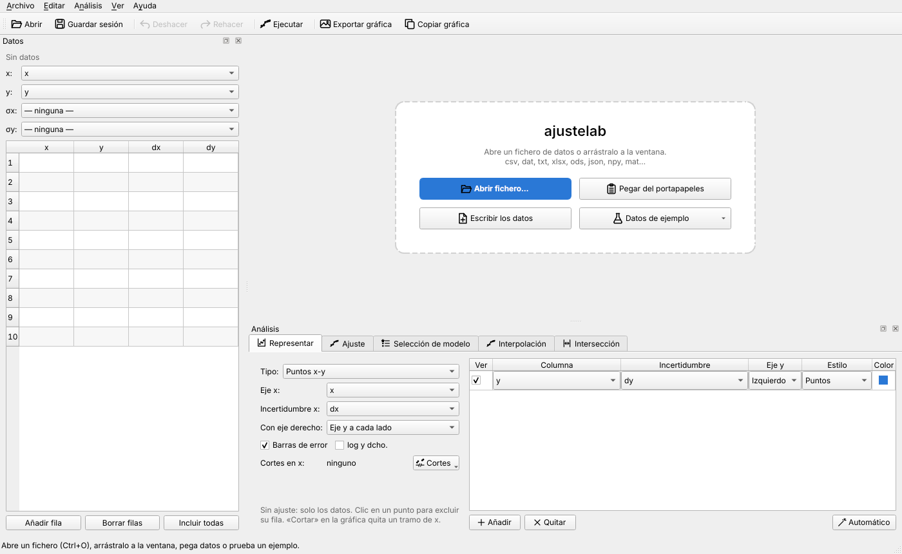

## Índice

1. [Flujo de trabajo](#flujo-de-trabajo)
2. [Datos](#datos): formatos, columnas, rango, guardar una parte
3. [Representar datos sin ajustar](#representar-datos-sin-ajustar): series, eje partido, histograma, barras, sectores, cajas, polar
4. [Ajuste y selección de modelo](#ajuste-y-selección-de-modelo)
5. [Interpolación](#interpolación): evaluar, tabla de valores y resumen para el informe
6. [Intersección](#intersección)
7. [Trabajar sobre la gráfica](#trabajar-sobre-la-gráfica): excluir, rango, marcas, mover y editar
8. [Personalizar la gráfica](#personalizar-la-gráfica)
9. [Exportar y guardar](#exportar-y-guardar)
10. [La ventana y los atajos](#la-ventana-y-los-atajos)

---

## Flujo de trabajo

1. **Carga los datos.** Usa *Abrir* (Ctrl+O), arrastra el fichero a la ventana, pega una tabla copiada de
   LibreOffice o Excel (Ctrl+Mayús+V) o escribe en una tabla vacía. Si es la primera vez, *Datos de
   ejemplo* carga diez conjuntos sintéticos: uno por cada tipo de análisis y de gráfica.
2. **Comprueba las columnas** x, y, σx y σy. Se asignan solas (ver [asignación de columnas](#asignación-de-columnas)).
   σ puede ser una columna, ninguna o un valor *constante* (p. ej. la resolución del instrumento).
3. **Elige una pestaña** y pulsa **Ctrl+Intro**:

| Pestaña | Qué hace |
|---|---|
| **Representar** | Dibuja las columnas que elijas **sin ajustar nada**: puntos x-y, histograma, barras, sectores, cajas / violín o polar. |
| **Ajuste** | Ajusta un modelo del catálogo o una expresión propia, con parámetros fijos y límites. Debajo están *Resumen* (veredicto, χ²/ν, p-valor, R²), *Informe* (texto y LaTeX) y *Evaluar* (f(x) ± σ, y la x que da un y₀ ± σ). |
| **Selección de modelo** | Prueba los 20 modelos automáticos (más los que añadas) y los ordena por AICc o BIC: ★ recomendado, ✓ compatible, ✗ incompatible. |
| **Interpolación** | Construye el interpolante, lo evalúa en un punto o en una tabla de x, y escribe un resumen para el informe. |
| **Intersección** | Divide la tabla en dos conjuntos, ajusta cada uno y calcula el punto de corte con su elipse de confianza. |

---

## Datos

### Formatos

| Tipo | Extensiones | Qué se detecta automáticamente |
|---|---|---|
| Texto | `.csv .tsv .txt .dat .prn .asc .lvm .xy .out` | Codificación (UTF-8, UTF-16, Windows-1252), separador (`,` `;` tabulador `\|` espacios), coma decimal, comentarios (`#` `%` `//` `!`), cabecera también en un comentario (estilo gnuplot), metadatos de osciloscopios, delimitador final sobrante y exponentes Fortran (`1.0D-3`) |
| Hojas de cálculo | `.xlsx .xlsm .xls .ods` | Bloque numérico dentro de la hoja, ignorando títulos y notas. Si varias hojas tienen datos, pregunta cuál abrir. |
| Otros | `.json .npy .npz .mat .parquet .feather` | Vectores del mismo tamaño o matriz (se transpone si está guardada por filas). `.parquet` y `.feather` requieren `pip install pyarrow`. |

Las filas con huecos en las columnas usadas se ignoran y el programa avisa de cuántas son.

Una **columna de etiquetas** (texto: `Cu`, `Muestra 1`, `2026-01-05`…) junto a columnas de números se lee
como texto en vez de rechazar el fichero; sirve para las categorías de las barras y los sectores. En la
tabla también se puede escribir o pegar texto. Las columnas de texto no aparecen en x, y, σx ni σy.

### Asignación de columnas

Si no indicas nada:

1. Si hay columnas cuyo nombre es el error de otra (`V` y `dV`, `t` y `t_err`, `I` y `sigma_I`), se
   emparejan por nombre.
2. Si no, se usa la posición: **2 columnas** → x, y · **3** → x, y, σy · **4 o más** → x, y, σx, σy
   (el mismo convenio que el script antiguo).

Las incertidumbres se interpretan como **desviaciones típicas (1σ)**.

### Rango de x

En el panel *Datos*, **Rango x** limita el análisis a un intervalo de x **escrito a mano**, sin tener que
acertar arrastrando sobre la gráfica: escribe *desde* y *hasta* y pulsa **Aplicar** (o Intro). Un lado
vacío no pone límite por ese lado (`desde 0`, `hasta` vacío = de 0 en adelante). Admite coma decimal.
Debajo se ve el rango y cuántos puntos quedan dentro («Rango de ajuste: 0 ≤ x ≤ 100 — 101 de 2001
puntos»); **✕** quita el rango.

Es el mismo rango que la herramienta *Rango* de la gráfica: lo que hagas con una se ve en la otra, se
deshace con Ctrl+Z y se guarda en la sesión. Los puntos de fuera siguen en la tabla, en gris.

### Guardar una parte de los datos como fichero nuevo

*Archivo → Guardar datos como… (todo o una parte)* (Ctrl+Mayús+D) guarda la tabla, o un trozo, en un
fichero nuevo. Sirve, por ejemplo, para quedarte con los 100 primeros segundos de una medida de 2000 s.

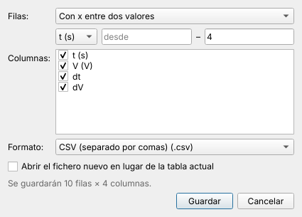

| Filas | Qué guarda |
|---|---|
| Todas las filas | La tabla entera. |
| Solo las incluidas | Sin las excluidas ni las que caen fuera del rango. |
| Las del rango de ajuste | Las que están dentro del rango de x actual. |
| Con x entre dos valores | Las de una columna (la x, o la que elijas) entre *desde* y *hasta*; un lado vacío no limita. |
| Filas de … a … | Por número de fila, como se ven en la tabla. |
| Las seleccionadas en la tabla | Las filas que tengas seleccionadas. |

Además eliges **qué columnas** guardar y el **formato**: CSV, CSV con `;` y coma decimal (el que abre
bien Excel en español), texto con tabuladores, Excel, OpenDocument (LibreOffice) o JSON. Con *Abrir el
fichero nuevo* se abre al guardarlo, en lugar de la tabla actual. El resumen de abajo dice cuántas filas
y columnas se guardarán.

En la tabla, **clic derecho → Guardar estas filas como fichero nuevo…** abre el mismo diálogo con las
filas seleccionadas.

---

## Representar datos sin ajustar

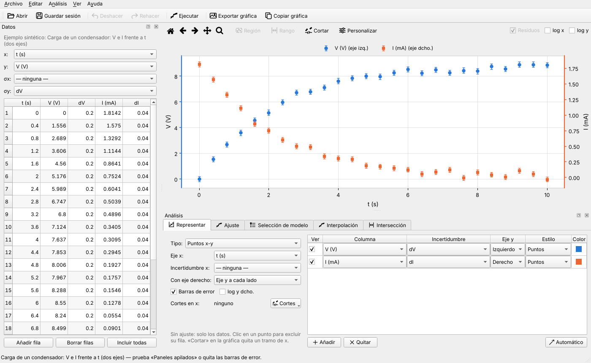

Al abrir un fichero, la pestaña **Representar** propone sola qué dibujar. La primera columna (o la
x del panel *Datos*) va al eje x, y cada columna que no sea una incertidumbre es una serie. Las
incertidumbres se emparejan por el nombre: `dV`, `V_err` o `σV` con `V (V)`. Con dos series de
escalas muy distintas, la segunda pasa al eje derecho. Todo se cambia en la tabla de series:

- **Incertidumbre**: la columna de σ de cada serie (y de x). *Barras de error* las enseña u oculta todas a la vez.
- **Eje y**: izquierdo o derecho. Cada eje se colorea como su serie, y la leyenda indica a qué eje
  pertenece cada una.
- **Estilo**: puntos, línea o puntos y línea. **Color**: clic para elegirlo, clic derecho para volver al
  automático. El color sigue a la serie: quitar una no cambia el de las demás.
- **Con eje derecho → Paneles apilados**: en vez de dos escalas en el mismo panel, dos paneles con la
  misma x.

> Con dos ejes y en el mismo panel, dónde se cruzan las curvas depende de cómo se escale cada eje, y
> puede sugerir una relación que no existe. Para comparar formas, los paneles apilados son más honestos.

Clic en un punto excluye su fila (afecta también a los ajustes). La escala logarítmica del eje
derecho está en *log y dcho.* y su etiqueta, en *Personalizar*. El selector **Tipo** cambia entre puntos
x-y y los demás tipos de gráfica. Cada tipo recuerda su configuración, y todo se guarda en la sesión.

### Eje x partido

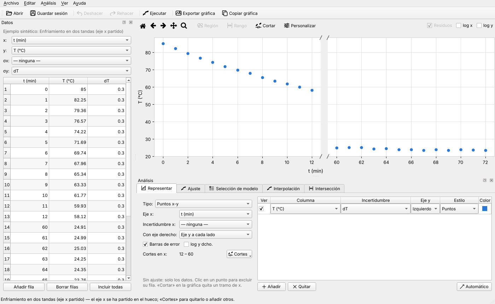

Cuando hay un tramo de x sin datos (dos tandas de medidas separadas, o un conjunto de en medio que
has borrado), el botón **Cortes** del panel lo quita y la gráfica se acorta: el eje se parte en tramos
con la misma escala, separados por `//`. Hay tres formas:

- **Cortar los huecos grandes**: detecta los saltos de x mucho mayores que el paso típico (más de 6
  veces y más del 12 % del rango).
- **Elegir el tramo en la gráfica**: activa la herramienta **Cortar** y arrastra en horizontal sobre lo que sobra.
- **Escribir el tramo**: `12; 45` quita lo que hay entre 12 y 45.

Los puntos que caen en un corte no se dibujan ni se exportan (siguen en la tabla). Funciona con los dos
ejes y, con paneles apilados y con escala logarítmica. Cada corte se quita desde el mismo menú.

### Histograma

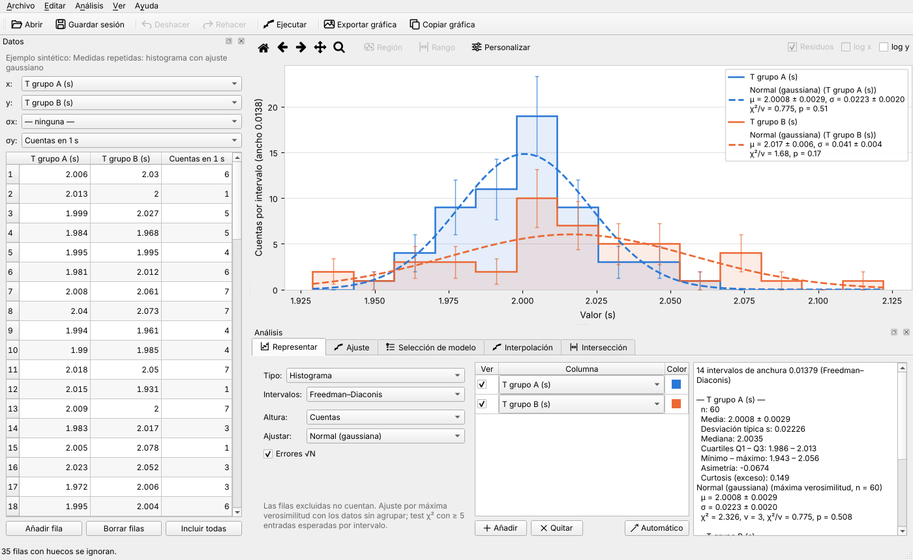

- **Columnas**: una o varias. Con varias se usan los mismos intervalos (calculados con todos los datos)
  y se dibujan como contornos para que se vean todas.
- **Intervalos**: *Freedman–Diaconis* (la de por defecto, robusta frente a colas y valores atípicos),
  *Scott*, *Sturges*, *√n*, número fijo o anchura fija. Con datos enteros (cuentas), los intervalos se
  centran en los enteros.
- **Altura**: cuentas, frecuencia relativa o densidad de probabilidad (área 1). **Errores √N** (Poisson).
- **Ajustar** una normal (μ, σ), una Poisson (λ) o una exponencial (τ) por máxima verosimilitud, con el
  test χ² de Pearson. A la derecha salen la estadística de cada columna (media ± error, desviación
  típica, mediana, cuartiles, asimetría, curtosis) y el resultado del ajuste. Ver
  [Histogramas](ESTADISTICA.md#histogramas) en la base estadística.

Al pasar el ratón por un intervalo se ven sus límites, N ± √N y las entradas esperadas por el ajuste.

### Barras, sectores, cajas y polar

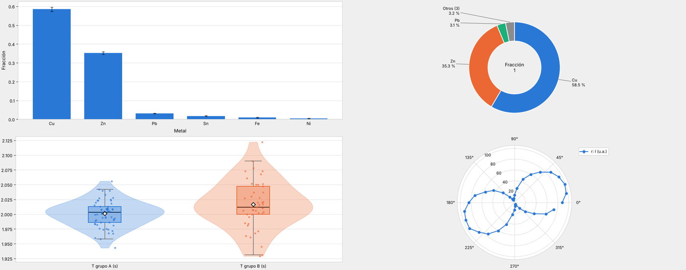

| Tipo | Qué dibuja |
|---|---|
| **Barras** | Una barra por fila. Las categorías salen de una columna de texto, de números o del número de fila. Una o varias series (barras agrupadas) con su incertidumbre; verticales u horizontales, en el orden de la tabla o de mayor a menor, con el valor encima si quieres. |
| **Sectores** | Una columna de valores (≥ 0) con sus etiquetas, en anillo (con el total en el centro) o tarta. Van de mayor a menor desde las 12 en sentido horario; los menores del umbral (3 % por defecto) se juntan en «Otros» y como mucho hay 8. *Ver como barras ordenadas* pasa los mismos datos a barras, que se comparan mejor. |
| **Cajas / violín** | Una caja por columna: mediana, cuartiles y bigotes de Tukey (1.5·IQR). Con violín se ve además la forma de la distribución; con *Puntos*, todos los datos; ◆ es la media. Al pasar el ratón salen n, media ± error, mediana, cuartiles y atípicos. |
| **Polar** | Ángulo θ (en grados o radianes) y una o varias series de radios, con 0 a la derecha y sentido antihorario (convenio matemático) o 0 arriba y sentido horario (brújula). |

Las filas excluidas no cuentan en histogramas, barras, sectores ni cajas; en x-y y polar se ven huecas.
En todos los tipos, *Exportar gráfica* guarda la figura y los números dibujados en CSV (intervalos y
cuentas, valores de las barras, estadísticos de las cajas…).

---

## Ajuste y selección de modelo

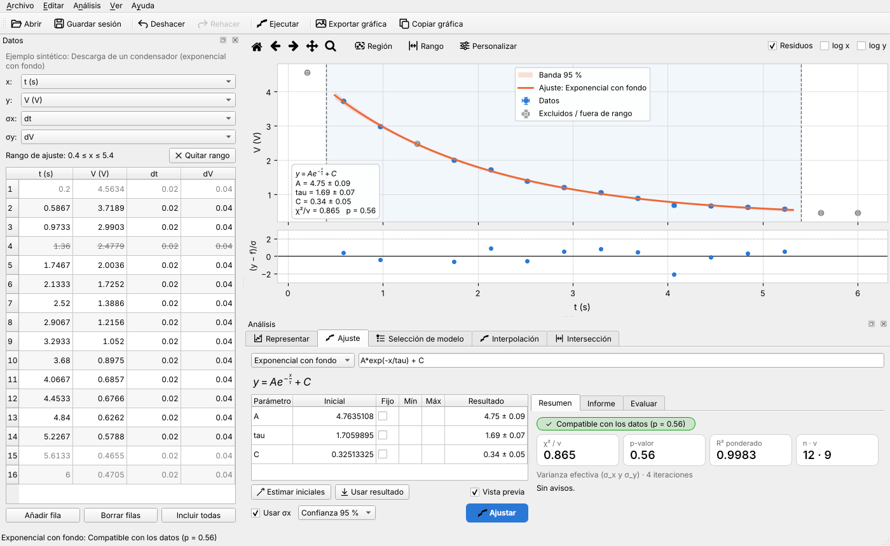

En **Ajuste** eliges un modelo del [catálogo](ESTADISTICA.md#catálogo-de-modelos) o escribes uno propio
(`A*exp(-x/tau) + C`). La vista previa dibuja el modelo con los valores iniciales antes de ajustar. En la
tabla de parámetros:

- **Fijo** mantiene un parámetro en su valor inicial, por ejemplo el fondo C medido aparte. El ajuste
  se hace solo con los demás y los grados de libertad se cuentan bien.
- **Mín/Máx** acota un parámetro, por ejemplo τ > 0.
- **Usar resultado** copia los valores ajustados como iniciales para el siguiente intento.

Antes de ajustar se comprueban las incoherencias (mín > máx, inicial fuera de límites, todos fijos) y
se marcan en rojo. Las **bandas** pueden ser de confianza al 68 % o al 95 % (incertidumbre de la curva)
o de predicción al 95 % (además, la dispersión de una medida nueva).

**Selección de modelo** ajusta todo el catálogo y ordena los modelos por AICc o BIC. La columna *Ver*
superpone hasta tres modelos en la gráfica para compararlos; con doble clic, el modelo pasa a *Ajuste*.
Cómo se decide está en [Selección de modelo](ESTADISTICA.md#selección-de-modelo).

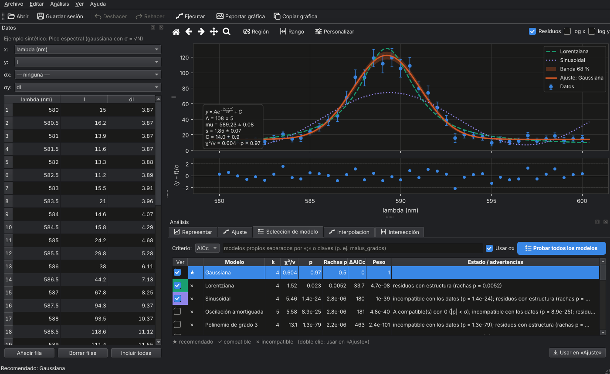

---

## Interpolación

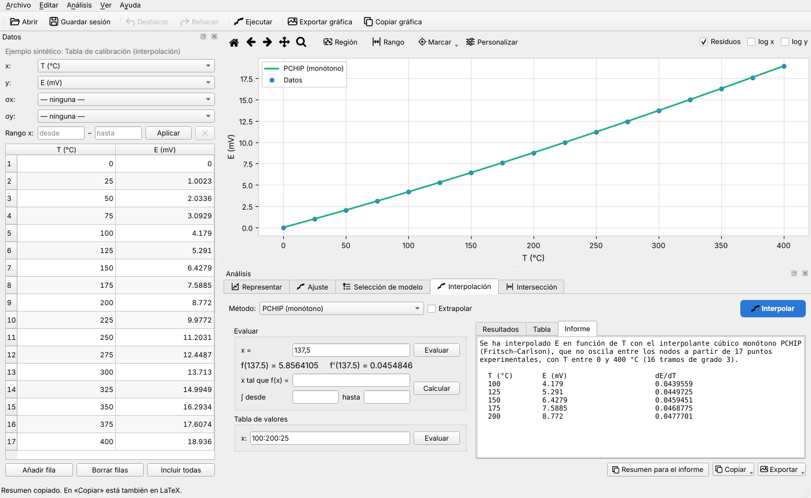

Elige el **método** ([cuál usar](ESTADISTICA.md#interpolación)) y pulsa **Interpolar**. Después:

- **Evaluar**: escribe una x (p. ej. `17`) y pulsa Intro. Sale f(x) y f′(x) al momento y, si los datos
  tienen incertidumbre, su σ por Monte Carlo en cuanto se calcula. Fuera del rango de los datos lo
  avisa (marca *Extrapolar* si de verdad quieres salir de él).
- **x tal que f(x) = …** e **∫ desde … hasta …**: la inversa y la integral, con su incertidumbre, al
  pulsar *Calcular*.
- **Tabla de valores**: una lista de x (`1; 2; 5`) o un rango `inicio:fin:paso` (`0:10:0,5`; `0:10` da
  11 puntos), hasta 10 000 valores. La pestaña *Tabla* muestra x, f, σ_f, f′ y σ_f′.
- **Resumen para el informe**: en lugar de pegar decenas de tramos del spline, escribe un párrafo con
  el método, el número de puntos y el rango, la incertidumbre típica de la curva y, si has hecho una
  tabla de valores, esa tabla. Se copia al portapapeles; en *Copiar* está también en **LaTeX** (con una
  tabla `booktabs`).
- **Exportar**: la tabla de valores en CSV, el resumen en `.tex` o `.txt`, y los tramos (polinomio de
  cada intervalo) en texto, LaTeX o CSV por si los necesitas de verdad.

---

## Intersección

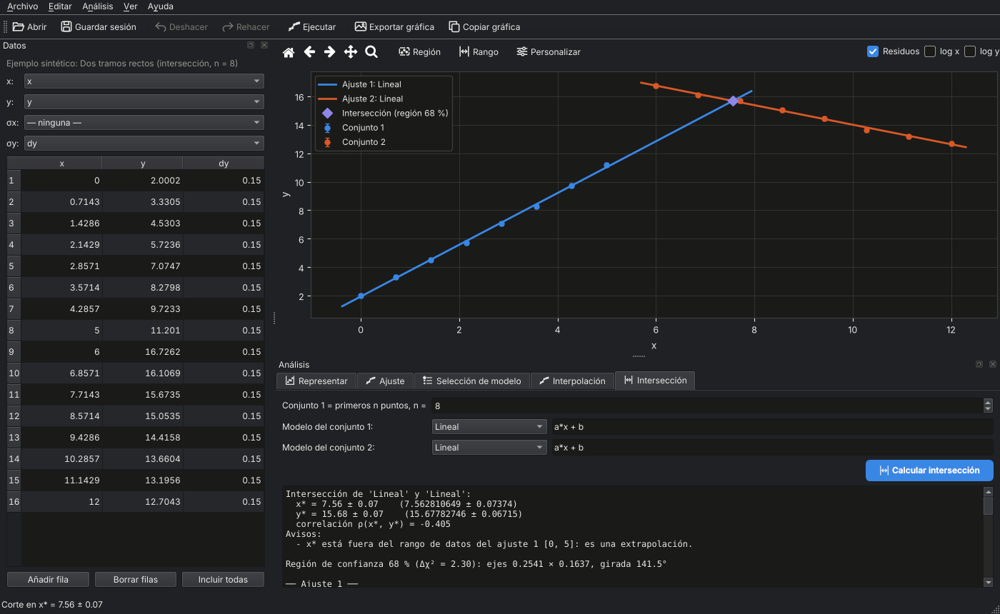

Divide la tabla en dos conjuntos (los *n* primeros puntos y el resto), ajusta un modelo a cada uno y
calcula el punto de corte (x\*, y\*) con su matriz de covarianza y la elipse de confianza. Ver
[Intersección](ESTADISTICA.md#intersección).

---

## Trabajar sobre la gráfica

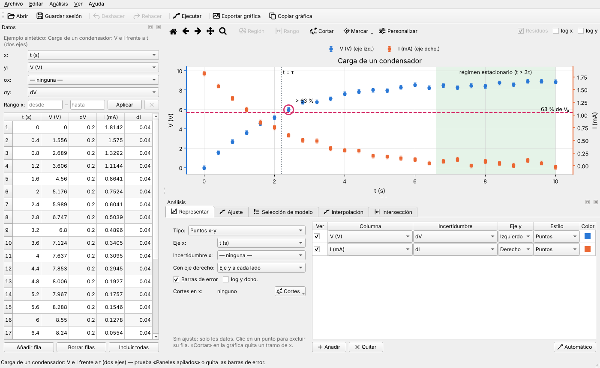

| Herramienta | Qué hace |
|---|---|
| **Clic en un punto** | Lo excluye o lo vuelve a incluir. La fila se tacha y el ajuste se recalcula al momento. |
| **Región** | Arrastra un rectángulo para excluir de una vez todos los puntos que encierra. |
| **Rango** | Arrastra en horizontal para ajustar solo un intervalo de x (o escríbelo en el panel *Datos*, ver [Rango de x](#rango-de-x)). |
| **Cortar** | Arrastra en horizontal sobre un tramo sin datos para partir el eje x (en *Representar*). |
| **Marcar ▾** | Señala algo importante: un **punto** (clic en él), un **tramo de x** (arrastra), una **línea vertical** o **horizontal** (clic). |
| **Personalizar** | Todas las opciones de la gráfica (ver abajo). |

### Marcas

Al crear una marca se abre un diálogo para darle **texto**, **color**, **forma** y **tamaño** (punto),
**tipo y grosor de línea** (líneas), **opacidad** (tramo) y si sale en la **leyenda**. Las coordenadas se
pueden corregir a mano: al marcar un punto con el ratón, la marca se pega al dato más cercano, pero
también puedes escribir la x y la y exactas. Con dos ejes y, eliges a cuál se refiere.

- **Doble clic** en una marca la edita; **clic derecho** sobre ella la edita o la quita.
- **Clic derecho** en cualquier sitio: *Marcar este punto…*, *Línea vertical aquí…*, *Línea horizontal aquí…*.
- *Marcar ▾ → Editar las marcas…* (o la pestaña **Marcas** de *Personalizar*) las lista todas para
  añadir, editar o quitar.

Las marcas se dibujan en todos los tipos de gráfica menos en sectores (en polar, solo los puntos), se
exportan con la figura y se guardan en la sesión. Al abrir otros datos se borran, como los textos y los
límites.

### Mover y editar sobre la gráfica

- **Arrastra** el **título**, la **leyenda**, las **etiquetas de los ejes**, el **cuadro de resultados** o
  un **texto** a donde quieras (el cursor cambia al pasar por encima).
- **Doble clic** para editarlos (en la leyenda, abre sus opciones).
- **Clic derecho** para añadir un texto en ese punto o una flecha que lo señale, devolver un elemento a
  su sitio o restablecer todas las posiciones.

Todo lo que cambia los datos se puede **deshacer y rehacer** (Ctrl+Z / Ctrl+Mayús+Z): editar celdas,
pegar, renombrar columnas, excluir puntos o fijar el rango.

---

## Personalizar la gráfica

| Gráfica personalizada (plantilla *Revista*, leyenda y cuadro movidos, texto con flecha) | Diálogo *Personalizar* |
|---|---|
| 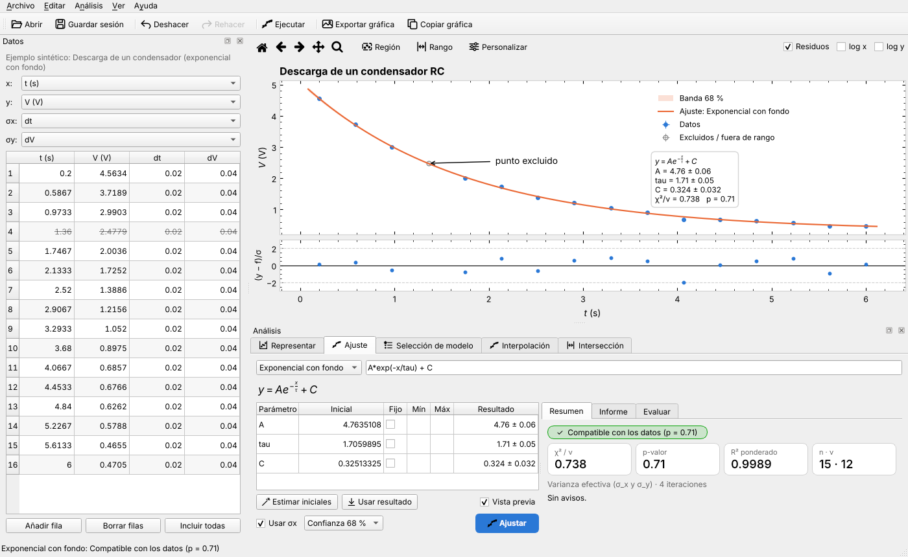 | 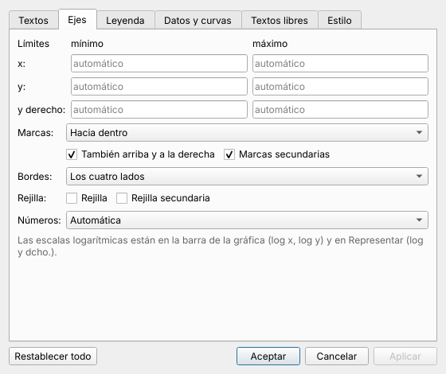 |

| Pestaña | Opciones |
|---|---|
| **Textos** | Título (alineación, tamaño, negrita), etiquetas de los ejes (admiten LaTeX, p. ej. `$V_0$ (V)`), tamaño de letra y un botón para devolver a su sitio lo que hayas movido. |
| **Ejes** | Límites de x, y e y derecho (vacío = automático), marcas hacia fuera, hacia dentro o a los dos lados, también arriba y a la derecha, marcas secundarias, bordes completos o solo abajo y a la izquierda, rejilla principal y secundaria, y notación de los números (automática, científica ×10ⁿ o sin exponente). |
| **Leyenda** | Mostrarla, posición (dentro, en 9 sitios, o fuera: a la derecha, encima o debajo), columnas, tamaño de letra, título y marco. |
| **Datos y curvas** | Tamaño de los puntos, grosor de las líneas, de las curvas ajustadas y de las barras de error, topes de las barras, color de los datos y del ajuste, y el cuadro de resultados. |
| **Marcas** | Los puntos, tramos y líneas marcados: añadir, editar y quitar. |
| **Textos libres** | Los textos añadidos: contenido, tamaño y, si señalan algo, las coordenadas de la flecha. |
| **Estilo** | Plantillas: *Por defecto*, *Revista (física)* (marcas hacia dentro en los cuatro lados, sin rejilla), *Presentación* (letra y líneas grandes), *Minimalista* y las que guardes tú. *Usar el estilo actual en las gráficas nuevas* lo deja como predeterminado. |

*Aplicar* enseña el cambio sin cerrar el diálogo. Una plantilla guarda solo el estilo, no los textos, los
límites, las marcas ni las posiciones. Al abrir otros datos se borran el título, las etiquetas, los
límites, los textos y las marcas (eran de los datos anteriores); el estilo y las posiciones se quedan.
Todo va en la sesión y se respeta al exportar: con otro tamaño de letra, el título, la leyenda y los
textos cambian en proporción.

---

## Exportar y guardar

| Acción | Resultado |
|---|---|
| *Exportar gráfica* (Ctrl+E) | Diálogo con vista previa al tamaño real (ver abajo). |
| *Copiar gráfica* (Ctrl+Mayús+C) | Con los últimos ajustes de exportación, como imagen y como SVG: Word pega la imagen; Inkscape y LibreOffice, la versión vectorial. |
| *Copiar LaTeX* (pestaña *Informe*) | Tabla `tabular` con los parámetros redondeados. |
| *Guardar sesión* (Ctrl+S) | Fichero `.ajustelab` (JSON) con la tabla, las columnas, los puntos excluidos, el rango, el modelo con sus parámetros fijos y límites, las opciones de la gráfica (con marcas y textos) y la pestaña activa. Al abrirlo se recupera todo y se rehace el ajuste. |
| *Guardar informe* | Texto de la pestaña activa. |
| *Guardar datos como…* (Ctrl+Mayús+D) | La tabla o una parte en csv, xlsx, ods… (ver [Guardar una parte](#guardar-una-parte-de-los-datos-como-fichero-nuevo)). |

### Exportar la gráfica

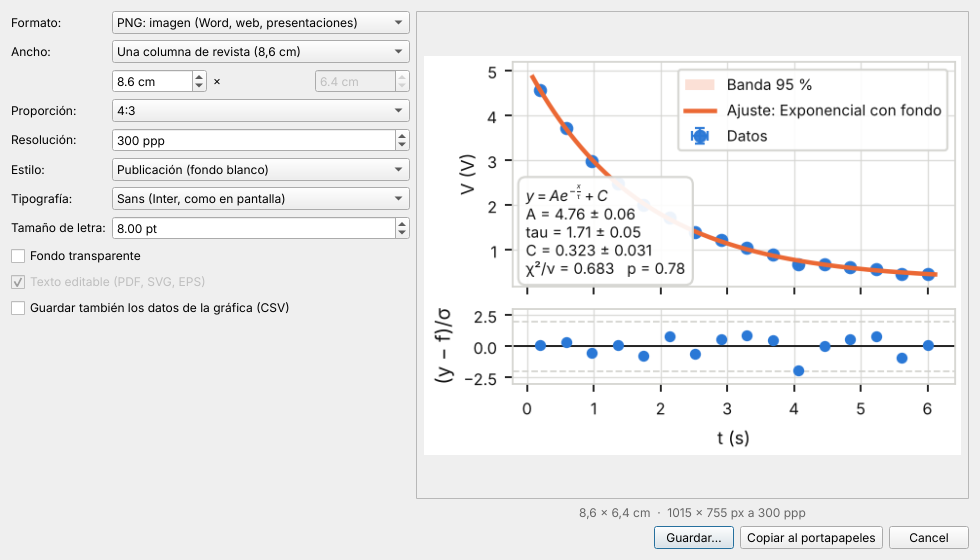

- **Vista previa** de cómo saldrá, a escala, con el tamaño final en cm y en píxeles.
- **Formatos**: PNG y TIFF (imagen; TIFF sin pérdidas, para imprenta), PDF, SVG y EPS (vectoriales). EPS
  no admite transparencias: las bandas de confianza saldrían opacas, y el diálogo lo avisa.
- **Tamaño exacto en cm**: anchos de revista (8,6 y 17,8 cm, los de APS), informe, diapositiva y póster,
  con proporción fija (4:3, 3:2, áurea, 16:9, 1:1) o libre. El fichero mide exactamente eso: el
  contenido se encaja dentro, no se recorta después.
- **Tipografía y tamaño de letra** propios de la exportación: *Sans* o *Serif* (STIX, tipo Times, con
  fórmulas a juego, como LaTeX con `newtx`). El tamaño es el real en el papel; las revistas suelen pedir 7–9 pt.
- **Texto editable**: en PDF y EPS las fuentes van incrustadas como TrueType (lo que piden las
  revistas); en SVG el texto sigue siendo texto, editable en Inkscape. Sin marcar, en SVG se convierte en trazos.
- **Estilo** *publicación* (fondo blanco aunque uses el tema oscuro) o *como en pantalla*, y fondo
  transparente.
- **Datos de la gráfica en CSV**: puntos, curva ajustada y bandas en ficheros junto a la figura
  (`figura_datos.csv`, `figura_ajuste.csv`…), para rehacerla con pgfplots o donde quieras.

Los ajustes se recuerdan entre sesiones. *Abrir reciente* recuerda los 8 últimos ficheros. Al cerrar o
abrir otro fichero con cambios sin guardar, el programa pregunta antes de descartarlos.

---

## La ventana y los atajos

- **Tema**: *Ver → Tema* (sistema, claro u oscuro). Con *sistema* sigue al escritorio en vivo; en
  Windows 11 y macOS usa el estilo nativo y en Linux, Fusion.
- **Coma decimal**: *Ver → Coma decimal* muestra los resultados como `1,71 ± 0,05` en la interfaz,
  en la gráfica y en el LaTeX (`{,}`). Los campos de texto admiten siempre la coma.
- **Paneles**: *Datos* y *Análisis* son paneles acoplables. Se pueden mover, desacoplar u ocultar, y la
  disposición se recuerda. *Ver → Restablecer disposición* vuelve a la original.
- **Muchos datos**: con decenas de miles de filas la tabla y la gráfica siguen siendo fluidas, y los
  cálculos largos van en segundo plano sin bloquear la ventana.

| Atajo | Acción |
|---|---|
| Ctrl+O | Abrir datos o sesión |
| Ctrl+S / Ctrl+Mayús+S | Guardar sesión / guardar como |
| Ctrl+Mayús+D | Guardar los datos (todo o una parte) como fichero nuevo |
| Ctrl+N | Nueva sesión |
| Ctrl+Mayús+V | Pegar el portapapeles como tabla nueva |
| Ctrl+Z / Ctrl+Mayús+Z (o Ctrl+Y) | Deshacer / rehacer |
| Ctrl+Intro | Ejecutar la pestaña activa |
| Ctrl+1 … Ctrl+5 | Ir a Representar, Ajuste, Selección, Interpolación, Intersección |
| Ctrl+E / Ctrl+Mayús+C | Exportar gráfica / copiarla al portapapeles |
| Ctrl+C / Ctrl+V (en la tabla) | Copiar la selección / pegar un bloque desde la celda actual |
| Supr (en la tabla) | Vaciar las celdas seleccionadas |
| Doble clic en una cabecera | Renombrar la columna |

En macOS, Ctrl equivale a ⌘. La lista también está en *Ayuda → Atajos de teclado*.

> **Pista:** en *Ayuda → Acerca de* hay algo más que la versión. 😉
